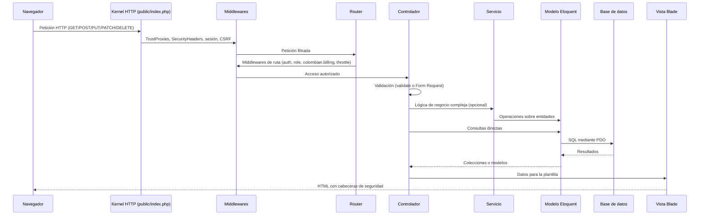
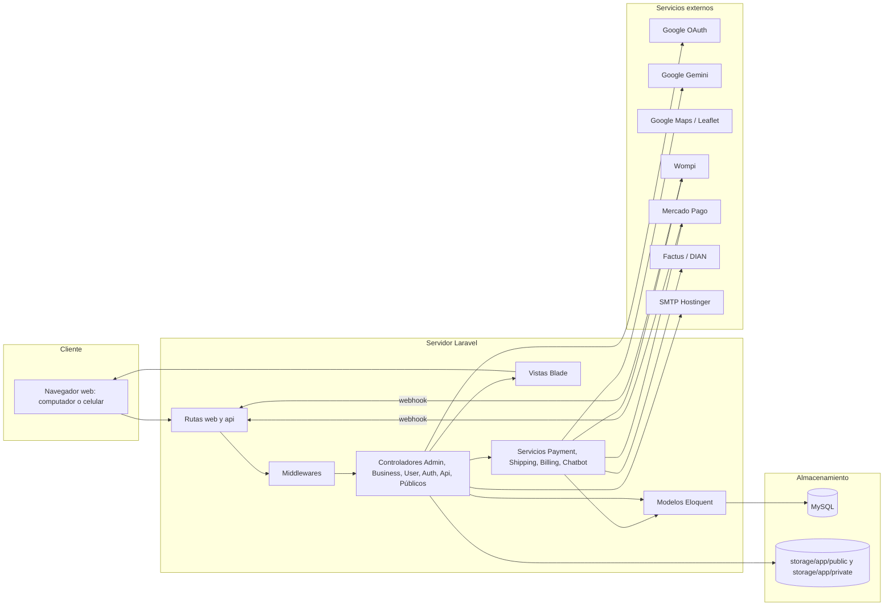
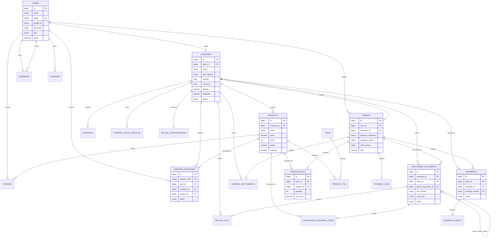
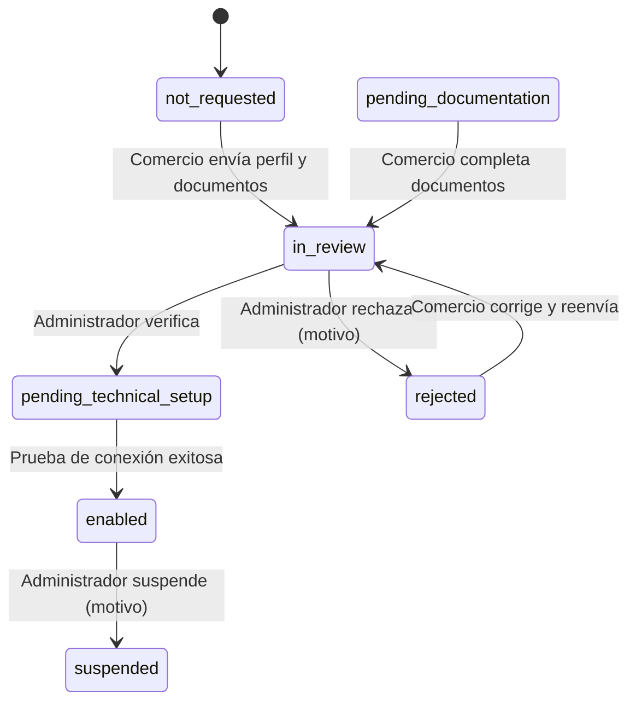

# Manual Técnico y de Desarrollador de Spotlight

| Campo | Valor |
|---|---|
| Nombre del software | Spotlight, marketplace de comercios locales |
| Tipo de documento | Manual técnico y de desarrollador |
| Repositorio | kevinvega-05/Spotlight (rama `main`) |
| Framework base | Laravel 12 sobre PHP 8.2 |
| Motor de base de datos | MySQL (producción), SQLite (desarrollo y pruebas) |
| Idioma de la aplicación | Español (`APP_LOCALE=es`), con soporte de inglés en el chatbot |
| Países soportados | Colombia (COP) y México (MXN) |

---

## 1. Introducción y arquitectura del sistema

### 1.1 Propósito del software

Spotlight es una plataforma web tipo marketplace multivendedor cuyo objetivo es dar visibilidad y canal de venta en línea a comercios locales, formales e informales, inicialmente en Villa de San Diego de Ubaté (Cundinamarca, Colombia), con soporte para comercios de México.

El sistema resuelve las siguientes necesidades:

- Publicación de un perfil comercial con logo, banner, horarios, ubicación geográfica y redes sociales.
- Catálogo de productos con inventario, precios, impuestos y estado activo o inactivo.
- Carrito de compras multivendedor con cálculo automático de envío, comisión de plataforma y liquidación por comercio.
- Pasarelas de pago Wompi (Colombia) y Mercado Pago (México), con métodos simulados de tarjeta, PSE y QR para el entorno de pruebas.
- Seguimiento de envíos con número de guía y portal público de rastreo.
- Compras asistidas internacionales entre Colombia y México.
- Facturación electrónica DIAN (Colombia) con proveedor sandbox y proveedor Factus.
- Control de gastos (egresos) del comercio y reportes en PDF.
- Mensajería interna entre usuarios y un asistente virtual basado en Google Gemini.
- Panel de administración para usuarios, empresas, verificaciones fiscales y compras asistidas.

### 1.2 Patrón arquitectónico MVC en Laravel

Spotlight sigue el patrón Modelo, Vista, Controlador (MVC) que impone Laravel, complementado con una capa de servicios para la lógica de negocio compleja.

| Capa | Ubicación | Responsabilidad |
|---|---|---|
| Rutas | `routes/web.php`, `routes/api.php` | Asocian cada URL y método HTTP con un controlador y sus middlewares |
| Middleware | `app/Http/Middleware` | Filtran la petición: autenticación, rol, país de facturación y cabeceras de seguridad |
| Form Requests | `app/Http/Requests` | Encapsulan reglas de validación reutilizables (registro de comercio y checkout) |
| Controladores | `app/Http/Controllers` | Reciben la petición, validan, invocan modelos o servicios y devuelven una vista, redirección o JSON |
| Servicios | `app/Services` | Lógica de dominio: pagos, liquidación, envíos, facturación electrónica y chatbot |
| Modelos | `app/Models` | Entidades Eloquent, relaciones, constantes de estado y atributos calculados |
| Políticas | `app/Policies` | Autorización a nivel de registro (perfil fiscal y documentos electrónicos) |
| Vistas | `resources/views` | Plantillas Blade renderizadas en el servidor con Bootstrap 5 y AlpineJS |
| Correo | `app/Mail`, `app/Notifications` | Mensajes transaccionales: código de verificación, estado de empresa y restablecimiento de contraseña |

### 1.3 Flujo de una petición



Pasos detallados:

1. El servidor web dirige la petición a `public/index.php`, que carga `bootstrap/app.php`.
2. Se aplican los middlewares globales: confianza en proxies (`trustProxies('*')`), `SecurityHeaders`, cifrado de cookies, sesión y verificación de token CSRF (excepto en los webhooks excluidos).
3. El router resuelve la ruta y ejecuta los middlewares asociados: `auth`, `role:admin|business|user`, `colombian.billing` y `throttle`.
4. El controlador valida la entrada. Si la validación falla, Laravel redirige al formulario con los mensajes de error en español y los datos anteriores (`old()`).
5. El controlador consulta o modifica modelos directamente o delega en un servicio (por ejemplo `SettlementService` o `ElectronicDocumentService`).
6. Las operaciones críticas (checkout) se ejecutan dentro de `DB::transaction` con bloqueo pesimista (`lockForUpdate`).
7. La respuesta se entrega como vista Blade, redirección con mensaje flash o JSON (APIs, chatbot, chat y webhooks).

### 1.4 Arquitectura lógica general



### 1.5 Soporte a la metodología de desarrollo XP (Extreme Programming)

La estructura del proyecto facilita las prácticas de Programación Extrema:

| Práctica XP | Soporte en Spotlight |
|---|---|
| Entregas pequeñas y frecuentes | Separación por módulos (rutas agrupadas por rol y prefijo) que permite liberar funcionalidades de forma incremental |
| Desarrollo guiado por pruebas | Suite PHPUnit 11 en `tests/Feature` con 13 archivos de pruebas funcionales y base de datos SQLite en memoria |
| Integración continua | Script `composer test` que limpia la configuración y ejecuta `php artisan test` |
| Diseño simple | Controladores delgados con lógica compleja delegada a servicios (`app/Services`) |
| Refactorización | Laravel Pint (`laravel/pint`) para estilo de código uniforme |
| Propiedad colectiva del código | Convenciones de Laravel, documentación en `AGENTS.md`, `CASOS_DE_USO.md`, `DIAGRAMAS_SISTEMA.md` y otros archivos del repositorio |
| Ritmo sostenible | Script `composer dev` que levanta servidor, cola, registro de eventos y Vite en un solo comando |
| Cliente presente | Datos de demostración (`DatabaseSeeder`) para validar historias de usuario con el cliente |

Pruebas funcionales existentes:

| Archivo | Área cubierta |
|---|---|
| `AdminPrivacyRestrictionsTest.php` | Restricciones de privacidad del administrador sobre los datos de usuarios |
| `BlackBoxCorrectionsTest.php` | Correcciones derivadas de pruebas de caja negra |
| `BusinessExpenseCrudTest.php` | Alta, edición y eliminación de egresos |
| `BusinessSalesPanelTest.php` | Panel de ventas del comercio |
| `ElectronicBillingTest.php` | Facturación electrónica DIAN |
| `ExampleTest.php` | Prueba base de Laravel |
| `InformalBusinessFormalizationGuideTest.php` | Guía de formalización para negocios informales |
| `MultinationalMarketplaceTest.php` | Operación Colombia y México |
| `ProductReviewTest.php` | Reseñas de productos |
| `ShipmentTrackingTest.php` | Rastreo de envíos |
| `UserLoginTest.php` | Inicio de sesión por rol |
| `UserMapTest.php` | Mapa de comercios |
| `WompiCheckoutAndSettlementTest.php` | Checkout con Wompi y liquidación por comercio |

---

## 2. Stack tecnológico y requisitos

### 2.1 Tecnologías del backend

| Tecnología | Versión requerida | Versión instalada (composer.lock) | Uso |
|---|---|---|---|
| PHP | ^8.2 | 8.2 o superior | Lenguaje del servidor |
| Laravel Framework | ^12.0 | v12.56.0 | Framework MVC |
| Laravel Socialite | * | v5.26.1 | Inicio de sesión con Google (OAuth 2.0) |
| Laravel Tinker | ^2.10.1 | v2.11.1 | Consola interactiva |
| Resend Laravel | ^1.4 | v1.4.0 | Transporte de correo alternativo |
| Resend PHP | dependencia | v1.13.0 | Cliente de la API de Resend |
| Guzzle HTTP | dependencia | 7.10.0 | Cliente HTTP para pasarelas y proveedores |

### 2.2 Dependencias de desarrollo (PHP)

| Paquete | Versión requerida | Versión instalada | Uso |
|---|---|---|---|
| beyondcode/laravel-er-diagram-generator | ^6.0 | 6.0.0 | Generación de diagramas entidad relación |
| fakerphp/faker | ^1.23 | v1.24.1 | Datos falsos para factories y seeders |
| laravel/pail | ^1.2.2 | v1.2.6 | Visualización de logs en tiempo real |
| laravel/pint | ^1.24 | v1.29.0 | Formateador de código |
| laravel/sail | ^1.41 | v1.57.0 | Entorno Docker opcional |
| mockery/mockery | ^1.6 | 1.6.12 | Dobles de prueba |
| nunomaduro/collision | ^8.6 | v8.9.3 | Reporte de errores en consola |
| phpunit/phpunit | ^11.5.50 | 11.5.55 | Pruebas automatizadas |

### 2.3 Tecnologías del frontend

| Tecnología | Versión | Origen | Uso |
|---|---|---|---|
| Blade | Incluido en Laravel 12 | Servidor | Motor de plantillas |
| Bootstrap | 5 | CDN jsDelivr | Maquetación responsiva y componentes visuales |
| Bootstrap Icons | 1.x | CDN jsDelivr | Iconografía |
| AlpineJS | 3.x | CDN | Interactividad ligera en formularios y paneles |
| GSAP | 3.x | CDN cdnjs | Animaciones |
| Vite | ^7.0.7 (7.3.2) | npm | Empaquetado de recursos |
| laravel-vite-plugin | ^2.0.0 (2.1.0) | npm | Integración Vite con Laravel |
| Tailwind CSS | ^4.0.0 (4.2.4) | npm | Utilidades CSS compiladas por Vite |
| @tailwindcss/vite | ^4.0.0 (4.2.4) | npm | Plugin de Tailwind para Vite |
| Axios | ^1.11.0 (1.16.0) | npm | Peticiones HTTP asíncronas |
| concurrently | ^9.0.1 (9.2.1) | npm | Ejecución simultánea de procesos en desarrollo |

Configuración de Vite (`vite.config.js`): entradas `resources/css/app.css` y `resources/js/app.js`, recarga automática activada, plugin `tailwindcss()` e ignorar cambios en `storage/framework/views`.

### 2.4 Servicios externos integrados

| Servicio | Propósito | Variables de entorno |
|---|---|---|
| Google OAuth 2.0 | Inicio de sesión con cuenta de Google | `GOOGLE_CLIENT_ID`, `GOOGLE_CLIENT_SECRET`, `GOOGLE_REDIRECT_URI` |
| Google Maps | Ubicación de comercios | `GOOGLE_MAPS_API_KEY` |
| Google Gemini 2.5 Flash | Chatbot asistente | `GEMINI_API_KEY` |
| Wompi | Pasarela de pagos Colombia | `WOMPI_PUBLIC_KEY`, `WOMPI_PRIVATE_KEY`, `WOMPI_INTEGRITY_SECRET`, `WOMPI_EVENT_SECRET`, `WOMPI_SANDBOX`, `WOMPI_CURRENCY`, `WOMPI_WEBHOOK_URL` |
| Mercado Pago | Pasarela de pagos México (y Colombia opcional) | `MERCADOPAGO_MX_*`, `MERCADOPAGO_CO_*`, `MERCADOPAGO_SANDBOX`, `MERCADOPAGO_WEBHOOK_URL` |
| Factus / DIAN | Facturación electrónica | `DIAN_BILLING_PROVIDER`, `DIAN_ENVIRONMENT`, `DIAN_QR_BASE_URL`, `FACTUS_SANDBOX_URL`, `FACTUS_PROD_URL`, `FACTUS_CLIENT_ID`, `FACTUS_CLIENT_SECRET` |
| SMTP Hostinger | Envío de correos transaccionales | `MAIL_MAILER`, `MAIL_HOST`, `MAIL_PORT`, `MAIL_ENCRYPTION`, `MAIL_USERNAME`, `MAIL_PASSWORD`, `MAIL_FROM_ADDRESS`, `MAIL_FROM_NAME` |

Parámetros comerciales del marketplace (`config/wompi.php`):

| Variable | Valor por defecto | Significado |
|---|---|---|
| `MARKETPLACE_PLATFORM_FEE_PERCENT` | 5.0 | Porcentaje de comisión de la plataforma sobre el subtotal de productos de cada comercio |
| `MARKETPLACE_SHIPPING_COST_PER_VENDOR` | 6000 | Costo de envío en COP cobrado por cada comercio incluido en el pedido |
| `MARKETPLACE_FREE_SHIPPING_THRESHOLD` | 120000 | Subtotal global a partir del cual el envío es gratuito |

### 2.5 Requisitos de hardware y software

#### Entorno de desarrollo

| Recurso | Mínimo | Recomendado |
|---|---|---|
| Procesador | 2 núcleos, 64 bits | 4 núcleos o más |
| Memoria RAM | 4 GB | 8 GB o más |
| Almacenamiento libre | 2 GB | 5 GB (dependencias de Composer y npm) |
| Sistema operativo | Windows 10, macOS 12 o Linux (Ubuntu 22.04) | Cualquiera de los anteriores actualizado |
| PHP | 8.2 | 8.3 |
| Extensiones PHP | `pdo_mysql`, `pdo_sqlite`, `mbstring`, `openssl`, `tokenizer`, `xml`, `ctype`, `json`, `bcmath`, `fileinfo`, `curl`, `gd` | Igual |
| Composer | 2.x | Última versión 2.x |
| Node.js | 20 LTS | 22 LTS |
| npm | 10 | Última versión |
| Base de datos | SQLite 3 | MySQL 8.0 o MariaDB 10.6 |
| Herramientas | Git, editor de código | Visual Studio Code con extensiones de PHP y Blade |

#### Entorno de producción

| Recurso | Mínimo | Recomendado |
|---|---|---|
| Alojamiento | Hosting compartido con PHP 8.2 y acceso SSH (por ejemplo Hostinger) | VPS de 2 vCPU |
| Memoria RAM | 1 GB | 2 GB o más |
| Almacenamiento | 5 GB | 20 GB SSD (imágenes y documentos) |
| Servidor web | Apache 2.4 con `mod_rewrite` o Nginx 1.20 | Nginx con PHP-FPM |
| Base de datos | MySQL 8.0 | MySQL 8.0 dedicado |
| Certificado SSL | Obligatorio (la cabecera HSTS exige HTTPS) | Let's Encrypt o certificado del proveedor |
| Correo | Cuenta SMTP con SSL en puerto 465 | Dominio propio con SPF y DKIM |
| Tareas programadas | Cron para el planificador y el procesador de colas | Supervisor para `queue:work` |

#### Requisitos del usuario final

- Navegador actualizado: Google Chrome, Mozilla Firefox, Microsoft Edge o Safari.
- JavaScript y cookies habilitados.
- Conexión a internet estable.
- Funciona en computadores, tabletas y celulares gracias al diseño responsivo de Bootstrap 5.

---

## 3. Estructura de directorios del proyecto

```text
spotlight/
├── app/
│   ├── Http/
│   │   ├── Controllers/
│   │   │   ├── Admin/            Panel de administración
│   │   │   ├── Api/              Webhooks de pago y API de rastreo
│   │   │   ├── Auth/             Google OAuth, verificación por código, restablecimiento de contraseña
│   │   │   ├── Business/         Panel del comercio
│   │   │   │   └── Billing/      Facturación electrónica DIAN
│   │   │   ├── User/             Panel del cliente
│   │   │   ├── AuthController.php
│   │   │   ├── ChatController.php
│   │   │   ├── ChatbotController.php
│   │   │   ├── CheckoutController.php
│   │   │   ├── Controller.php
│   │   │   ├── HomeController.php
│   │   │   └── PublicController.php
│   │   ├── Middleware/           RoleMiddleware, EnsureColombianBilling, SecurityHeaders
│   │   └── Requests/             BusinessRegisterRequest, StoreCheckoutRequest
│   ├── Mail/                     CompanyStatusUpdatedMail, GoogleVerificationMail
│   ├── Models/                   19 modelos Eloquent
│   ├── Notifications/            CustomResetPasswordNotification
│   ├── Policies/                 CompanyFiscalProfilePolicy, ElectronicDocumentPolicy
│   ├── Providers/                AppServiceProvider
│   └── Services/
│       ├── Billing/              BillingManager, ElectronicDocumentService, Providers (Sandbox, Factus)
│       ├── Payment/              WompiGatewayService, MercadoPagoGatewayService, SettlementService
│       ├── Shipping/             CarrierApiService, ShipmentTrackingService
│       └── ChatbotService.php
├── bootstrap/app.php             Registro de rutas, middlewares, alias y excepciones CSRF
├── config/                       app, auth, billing, cache, database, filesystems, logging,
│                                 mail, mercadopago, queue, services, session, wompi
├── database/
│   ├── factories/                Fábricas de datos de prueba
│   ├── migrations/               Esquema completo de la base de datos
│   └── seeders/                  DatabaseSeeder con datos de demostración
├── despliegue/                   spotlight-laravel.zip y spotlight-public_html.zip
├── lang/                         Traducciones (español)
├── public/                       index.php, css, images, favicon.ico, robots.txt
├── resources/
│   ├── css/app.css               Entrada de estilos para Vite
│   ├── js/app.js                 Entrada de scripts para Vite
│   └── views/
│       ├── admin/                assisted_purchases, companies, dashboard, fiscal_verifications,
│       │                         products, reports, users
│       ├── auth/                 login, register, forgot-password, reset-password,
│       │                         verify-form, verify-notice
│       ├── business/             assisted_purchases, billing, company, dashboard, expenses,
│       │                         formalization, partials, products, shipments
│       ├── chat/                 index, show
│       ├── checkout/             pse_authorize, qr_payment, result
│       ├── components/           chatbot-widget, cookie-banner
│       ├── emails/               company_status, google_verification, reset_password
│       ├── home/                 index
│       ├── layouts/              app (público), dashboard (paneles)
│       ├── partials/             sidebar
│       ├── public/               company, product, tracking
│       └── user/                 assisted_purchases, cart, chatbot, dashboard, map,
│                                 orders, panel, profile
├── routes/
│   ├── web.php                   Rutas web
│   ├── api.php                   API REST de rastreo y webhook Wompi
│   └── console.php               Comandos de consola
├── storage/
│   ├── app/public/               Archivos públicos: logos, banners, products, avatars,
│   │                             documents, expenses/invoices
│   └── app/private/              Archivos privados: fiscal_documents, XML y PDF de facturación
├── tests/
│   ├── Feature/                  13 pruebas funcionales
│   └── Unit/                     Pruebas unitarias
├── composer.json / composer.lock
├── package.json / package-lock.json
├── phpunit.xml
└── vite.config.js
```

Documentación complementaria incluida en la raíz: `README.md`, `AGENTS.md`, `CASOS_DE_USO.md`, `CHATBOT_README.md`, `DIAGRAMAS_SISTEMA.md`, `FACTURACION_ELECTRONICA_DIAN.md`, `PLAN_DESARROLLO_IA.md` y `RASTREO_ENVIOS_API.md`.

---

## 4. Diseño de la base de datos

### 4.1 Consideraciones generales

- Todas las tablas de negocio usan clave primaria `id` autoincremental (`BIGINT UNSIGNED`) y marcas de tiempo `created_at` y `updated_at`, salvo que se indique lo contrario.
- Las claves foráneas usan `foreignId()->constrained()`. La columna "Al eliminar" indica la acción referencial: `CASCADE` borra los registros hijos y `SET NULL` deja la referencia vacía.
- Los importes monetarios usan `DECIMAL` para evitar errores de redondeo.
- Los campos de país usan el código ISO de 2 letras (`CO`, `MX`) y los de moneda el código ISO de 3 letras (`COP`, `MXN`).

### 4.2 Tablas de infraestructura del framework

#### cache

| Campo | Tipo | Nulo | Por defecto | Descripción |
|---|---|---|---|---|
| key | VARCHAR(255) PK | No | | Clave de la entrada de caché |
| value | MEDIUMTEXT | No | | Valor serializado |
| expiration | INT (índice) | No | | Marca de tiempo de expiración |

#### cache_locks

| Campo | Tipo | Nulo | Por defecto | Descripción |
|---|---|---|---|---|
| key | VARCHAR(255) PK | No | | Clave del bloqueo |
| owner | VARCHAR(255) | No | | Propietario del bloqueo |
| expiration | INT (índice) | No | | Expiración del bloqueo |

#### jobs

| Campo | Tipo | Nulo | Por defecto | Descripción |
|---|---|---|---|---|
| id | BIGINT PK | No | | Identificador |
| queue | VARCHAR(255) (índice) | No | | Nombre de la cola |
| payload | LONGTEXT | No | | Trabajo serializado |
| attempts | TINYINT UNSIGNED | No | | Intentos realizados |
| reserved_at | INT UNSIGNED | Sí | | Momento de reserva |
| available_at | INT UNSIGNED | No | | Momento de disponibilidad |
| created_at | INT UNSIGNED | No | | Momento de creación |

#### job_batches

| Campo | Tipo | Nulo | Descripción |
|---|---|---|---|
| id | VARCHAR(255) PK | No | Identificador del lote |
| name | VARCHAR(255) | No | Nombre del lote |
| total_jobs | INT | No | Total de trabajos |
| pending_jobs | INT | No | Trabajos pendientes |
| failed_jobs | INT | No | Trabajos fallidos |
| failed_job_ids | LONGTEXT | No | Identificadores fallidos |
| options | MEDIUMTEXT | Sí | Opciones serializadas |
| cancelled_at | INT | Sí | Momento de cancelación |
| created_at | INT | No | Momento de creación |
| finished_at | INT | Sí | Momento de finalización |

#### failed_jobs

| Campo | Tipo | Nulo | Por defecto | Descripción |
|---|---|---|---|---|
| id | BIGINT PK | No | | Identificador |
| uuid | VARCHAR(255) UNIQUE | No | | Identificador universal |
| connection | TEXT | No | | Conexión de cola |
| queue | TEXT | No | | Nombre de la cola |
| payload | LONGTEXT | No | | Trabajo serializado |
| exception | LONGTEXT | No | | Traza del error |
| failed_at | TIMESTAMP | No | CURRENT_TIMESTAMP | Momento del fallo |

#### password_reset_tokens

| Campo | Tipo | Nulo | Descripción |
|---|---|---|---|
| email | VARCHAR(255) PK | No | Correo que solicitó el restablecimiento |
| token | VARCHAR(255) | No | Token cifrado |
| created_at | TIMESTAMP | Sí | Fecha de emisión |

#### sessions

| Campo | Tipo | Nulo | Descripción |
|---|---|---|---|
| id | VARCHAR(255) PK | No | Identificador de sesión |
| user_id | BIGINT (índice) | Sí | Usuario autenticado |
| ip_address | VARCHAR(45) | Sí | Dirección IP (IPv4 o IPv6) |
| user_agent | TEXT | Sí | Navegador del cliente |
| payload | LONGTEXT | No | Datos de sesión (incluye el carrito) |
| last_activity | INT (índice) | No | Última actividad |

### 4.3 Tablas de negocio

#### users

Usuarios de la plataforma en sus tres roles.

| Campo | Tipo | Nulo | Por defecto | Descripción |
|---|---|---|---|---|
| id | BIGINT PK | No | | Identificador |
| name | VARCHAR(255) | No | | Nombre completo |
| email | VARCHAR(255) UNIQUE | No | | Correo electrónico (usuario de acceso) |
| google_id | VARCHAR(255) | Sí | | Identificador de la cuenta de Google |
| email_verified_at | TIMESTAMP | Sí | | Fecha de verificación del correo |
| password | VARCHAR(255) | Sí | | Contraseña cifrada con bcrypt (nula si solo usa Google) |
| role | ENUM(user, business, admin) | No | user | Rol del usuario |
| phone | VARCHAR(255) | Sí | | Teléfono |
| phone_prefix | VARCHAR(10) | No | +57 | Indicativo telefónico |
| address | VARCHAR(255) | Sí | | Dirección |
| city | VARCHAR(100) | Sí | | Ciudad |
| state | VARCHAR(100) | Sí | | Departamento o estado |
| postal_code | VARCHAR(20) | Sí | | Código postal |
| country | VARCHAR(100) | Sí | | País |
| birthdate | DATE | Sí | | Fecha de nacimiento |
| document | VARCHAR(255) | Sí | | Documento de identidad |
| avatar | VARCHAR(255) | Sí | | Ruta o URL de la foto de perfil |
| active | BOOLEAN | No | true | Cuenta habilitada |
| remember_token | VARCHAR(100) | Sí | | Token de "recordarme" |
| created_at, updated_at | TIMESTAMP | Sí | | Auditoría |

#### companies

Perfil comercial de cada usuario con rol `business` (relación uno a uno).

| Campo | Tipo | Nulo | Por defecto | Descripción |
|---|---|---|---|---|
| id | BIGINT PK | No | | Identificador |
| user_id | FK users (CASCADE) | No | | Propietario |
| name | VARCHAR(255) | No | | Nombre visible de la empresa |
| tipo_negocio | ENUM(formal, informal) | No | informal | Tipo de negocio |
| razon_social | VARCHAR(255) | Sí | | Razón social (formal) |
| nit | VARCHAR(255) | Sí | | NIT (formal, Colombia) |
| tax_id | VARCHAR(50) | Sí | | Identificador tributario (RFC en México, NIT en Colombia) |
| camara_comercio_file | VARCHAR(255) | Sí | | Ruta del PDF de Cámara de Comercio |
| rut_file | VARCHAR(255) | Sí | | Ruta del PDF del RUT empresarial |
| nombre_representante | VARCHAR(255) | Sí | | Representante legal |
| email_representante | VARCHAR(255) | Sí | | Correo del representante legal |
| nombre_comercial | VARCHAR(255) | Sí | | Nombre comercial (informal) |
| cedula_propietario | VARCHAR(255) | Sí | | Cédula del propietario |
| rut_personal_file | VARCHAR(255) | Sí | | Ruta del PDF del RUT personal |
| habeas_data_accepted | BOOLEAN | No | false | Aceptación de la política de tratamiento de datos |
| country | CHAR(2) (índice) | No | CO | País del comercio |
| state | VARCHAR(100) | Sí | | Departamento o estado |
| city | VARCHAR(100) | Sí | | Ciudad o municipio |
| postal_code | VARCHAR(20) | Sí | | Código postal |
| currency | CHAR(3) | No | COP | Moneda |
| latitude | DECIMAL(10,8) | Sí | | Latitud |
| longitude | DECIMAL(11,8) | Sí | | Longitud |
| logo | VARCHAR(255) | Sí | | Ruta del logo |
| banner | VARCHAR(255) | Sí | | Ruta del banner |
| description | TEXT | Sí | | Descripción del negocio |
| category | VARCHAR(255) | Sí | | Categoría comercial |
| address | VARCHAR(255) | Sí | | Dirección física |
| phone | VARCHAR(255) | Sí | | Teléfono |
| phone_prefix | VARCHAR(10) | No | +57 | Indicativo |
| email | VARCHAR(255) | Sí | | Correo de contacto |
| instagram | VARCHAR(255) | Sí | | Usuario o enlace de Instagram |
| facebook | VARCHAR(255) | Sí | | Usuario o enlace de Facebook |
| website | VARCHAR(255) | Sí | | Sitio web |
| opening_time | VARCHAR(10) | No | 08:00 | Hora de apertura |
| closing_time | VARCHAR(10) | No | 19:00 | Hora de cierre |
| operating_days | JSON | Sí | | Días de atención |
| bank_name | VARCHAR(100) | Sí | | Banco para dispersión de pagos |
| account_type | VARCHAR(30) | Sí | | Tipo de cuenta: ahorros o corriente |
| account_number | VARCHAR(50) | Sí | | Número de cuenta |
| account_holder_name | VARCHAR(150) | Sí | | Titular de la cuenta |
| account_holder_doc_type | VARCHAR(10) | Sí | | Tipo de documento del titular: CC, NIT, CE, PP |
| account_holder_doc_number | VARCHAR(30) | Sí | | Número de documento del titular |
| wompi_merchant_id | VARCHAR(100) | Sí | | Identificador de comercio en Wompi |
| split_rule_id | VARCHAR(100) | Sí | | Regla de dispersión de pagos |
| status | ENUM(active, inactive, pending) | No | pending | Estado de publicación (el registro crea la empresa como active) |
| document_update_status | VARCHAR(255) | Sí | | Solicitud de cambio de documentos: requested o granted |
| document_update_reason | TEXT | Sí | | Motivo de la solicitud |
| created_at, updated_at | TIMESTAMP | Sí | | Auditoría |

Migraciones de datos asociadas: `update_company_locations_default` asigna coordenadas aleatorias alrededor de 5.3086, -73.8149 y una dirección en Villa de San Diego de Ubaté a los comercios sin ubicación; la migración multinacional asigna `country = 'CO'` a los registros sin país en `companies`, `products` y `orders`.

#### products

| Campo | Tipo | Nulo | Por defecto | Descripción |
|---|---|---|---|---|
| id | BIGINT PK | No | | Identificador |
| company_id | FK companies (CASCADE) | No | | Comercio propietario |
| country | CHAR(2) (índice) | No | CO | País |
| name | VARCHAR(255) | No | | Nombre del producto |
| sku | VARCHAR(50) | Sí | | Código interno |
| description | TEXT | Sí | | Descripción |
| price | DECIMAL(10,2) | No | | Precio de venta |
| cost_price | DECIMAL(10,2) | Sí | 0 | Costo de adquisición |
| currency | CHAR(3) | No | COP | Moneda |
| stock | INT | No | 0 | Unidades disponibles |
| tax_type | VARCHAR(10) | No | 01 | Tipo de impuesto: 01 IVA, 04 INC, 03 ICA, ZZ excluido |
| tax_rate | DECIMAL(5,2) | No | 19.00 | Tarifa del impuesto |
| unit_measure | VARCHAR(10) | No | 94 | Unidad de medida DIAN (94 = unidad) |
| standard_code | VARCHAR(50) | Sí | | Código estándar del producto |
| image | VARCHAR(255) | Sí | | Ruta de la imagen |
| active | BOOLEAN | No | true | Visible en el catálogo |
| featured | BOOLEAN | No | false | Destacado en la página principal |
| created_at, updated_at | TIMESTAMP | Sí | | Auditoría |

#### orders

Un pedido por comercio. Un mismo pago puede agrupar varios pedidos mediante `payment_reference`.

| Campo | Tipo | Nulo | Por defecto | Descripción |
|---|---|---|---|---|
| id | BIGINT PK | No | | Identificador |
| user_id | FK users (CASCADE) | No | | Comprador |
| company_id | FK companies (SET NULL) | Sí | | Comercio vendedor |
| country | CHAR(2) (índice) | No | CO | País del pedido |
| reference | VARCHAR(80) UNIQUE | Sí | | Referencia única del pedido |
| payment_reference | VARCHAR(80) (índice) | Sí | | Referencia maestra de pago (`SPOT-PAY-XXXXXX-timestamp`) |
| transaction_id | VARCHAR(120) (índice) | Sí | | Transacción en la pasarela |
| payment_method | VARCHAR(50) | Sí | | Método de pago usado |
| payment_gateway | VARCHAR(30) | No | wompi | Pasarela: wompi o mercadopago |
| payment_status | VARCHAR(30) | No | pending | pending, processing, approved, declined, voided, error |
| order_status | VARCHAR(30) | No | pending_payment | pending_payment, confirmed, in_preparation, shipped, delivered, cancelled |
| shipping_address | JSON | Sí | | Datos de entrega y facturación |
| total | DECIMAL(10,2) | No | 0 | Total del pedido |
| currency | CHAR(3) | No | COP | Moneda |
| subtotal_company | DECIMAL(12,2) | Sí | | Subtotal de productos del comercio |
| shipping_cost_company | DECIMAL(10,2) | Sí | | Envío asignado al comercio |
| platform_fee | DECIMAL(10,2) | Sí | | Comisión de la plataforma |
| net_company_amount | DECIMAL(12,2) | Sí | | Neto a favor del comercio |
| settlement_status | VARCHAR(30) | No | pending | pending, processing, settled, failed |
| total_company_settlement | DECIMAL(12,2) | Sí | | Total liquidado al comercio |
| status | ENUM(pending, paid, shipped, delivered) | No | paid | Estado heredado (compatibilidad) |
| billing_status | VARCHAR(30) | No | not_billed | not_billed, in_process, billed, exempt |
| payment_method_code | VARCHAR(10) | No | 10 | Código DIAN del medio de pago |
| payment_due_date | DATE | Sí | | Fecha de vencimiento del pago |
| created_at, updated_at | TIMESTAMP | Sí | | Auditoría |

#### order_details

| Campo | Tipo | Nulo | Por defecto | Descripción |
|---|---|---|---|---|
| id | BIGINT PK | No | | Identificador |
| order_id | FK orders (CASCADE) | No | | Pedido |
| company_id | FK companies (SET NULL) | Sí | | Comercio |
| product_id | FK products (CASCADE) | No | | Producto |
| product_name | VARCHAR(255) | Sí | | Nombre del producto al momento de la compra |
| product_sku | VARCHAR(50) | Sí | | SKU al momento de la compra |
| quantity | INT | No | | Cantidad |
| unit_price | DECIMAL(10,2) | No | | Precio unitario |
| subtotal | DECIMAL(10,2) | No | | Subtotal de la línea |
| tax_type | VARCHAR(10) | No | 01 | Tipo de impuesto |
| tax_rate | DECIMAL(5,2) | No | 19 | Tarifa |
| tax_amount | DECIMAL(10,2) | No | 0 | Valor del impuesto |
| discount_amount | DECIMAL(10,2) | No | 0 | Descuento |
| platform_fee | DECIMAL(10,2) | No | 0 | Comisión de la línea |
| company_payout | DECIMAL(12,2) | No | 0 | Pago al comercio por la línea |
| created_at, updated_at | TIMESTAMP | Sí | | Auditoría |

#### expenses

| Campo | Tipo | Nulo | Por defecto | Descripción |
|---|---|---|---|---|
| id | BIGINT PK | No | | Identificador |
| company_id | FK companies (CASCADE) | No | | Comercio |
| concept | VARCHAR(255) | No | | Concepto del egreso |
| category | VARCHAR(255) | Sí | Operativo | Categoría |
| amount | DECIMAL(10,2) | No | | Valor |
| date | DATE | No | | Fecha del egreso |
| description | TEXT | Sí | | Detalle |
| invoice_path | VARCHAR(255) | Sí | | Ruta del soporte (PDF o imagen) |
| invoice_filename | VARCHAR(255) | Sí | | Nombre original del soporte |
| created_at, updated_at | TIMESTAMP | Sí | | Auditoría |

#### messages

| Campo | Tipo | Nulo | Por defecto | Descripción |
|---|---|---|---|---|
| id | BIGINT PK | No | | Identificador |
| sender_id | FK users (CASCADE) | No | | Remitente |
| receiver_id | FK users (CASCADE) | No | | Destinatario |
| message | TEXT | No | | Contenido |
| is_read | BOOLEAN | No | false | Leído por el destinatario |
| created_at, updated_at | TIMESTAMP | Sí | | Auditoría |

#### reviews

| Campo | Tipo | Nulo | Por defecto | Descripción |
|---|---|---|---|---|
| id | BIGINT PK | No | | Identificador |
| product_id | FK products (CASCADE) | No | | Producto calificado |
| user_id | FK users (CASCADE) | No | | Autor |
| rating | TINYINT UNSIGNED | No | 5 | Calificación de 1 a 5 |
| comment | TEXT | Sí | | Opinión |
| is_verified_purchase | BOOLEAN | No | false | El autor compró el producto |
| created_at, updated_at | TIMESTAMP | Sí | | Auditoría |

Restricción única: (`product_id`, `user_id`). Cada usuario tiene una sola reseña por producto, que se actualiza si vuelve a calificar.

#### tags

| Campo | Tipo | Nulo | Descripción |
|---|---|---|---|
| id | BIGINT PK | No | Identificador |
| name | VARCHAR(255) UNIQUE | No | Identificador corto (slug) |
| label | VARCHAR(255) | No | Etiqueta visible |
| icon | VARCHAR(255) | Sí | Ícono de Bootstrap Icons |
| color_class | VARCHAR(255) | Sí | Clase de color |
| theme | JSON | Sí | Configuración visual |
| created_at, updated_at | TIMESTAMP | Sí | Auditoría |

#### product_tag

| Campo | Tipo | Nulo | Descripción |
|---|---|---|---|
| id | BIGINT PK | No | Identificador |
| product_id | FK products (CASCADE) | No | Producto |
| tag_id | FK tags (CASCADE) | No | Etiqueta |
| created_at, updated_at | TIMESTAMP | Sí | Auditoría |

#### shipments

| Campo | Tipo | Nulo | Por defecto | Descripción |
|---|---|---|---|---|
| id | BIGINT PK | No | | Identificador |
| order_id | FK orders (CASCADE) | No | | Pedido |
| company_id | FK companies (CASCADE) | No | | Comercio remitente |
| tracking_number | VARCHAR(60) UNIQUE | No | | Número de guía |
| carrier | VARCHAR(40) | No | coordinadora | coordinadora, servientrega, interrapidisimo, envia, dhl, spotlight_express |
| carrier_name | VARCHAR(80) | No | Coordinadora Mercantil | Nombre de la transportadora |
| status | VARCHAR(30) | No | preparing | preparing, dispatched, in_transit, out_for_delivery, delivered, failed |
| origin_city | VARCHAR(255) | No | Bogotá D.C. | Ciudad de origen |
| destination_city | VARCHAR(255) | No | Bogotá D.C. | Ciudad de destino |
| destination_address | TEXT | Sí | | Dirección de entrega |
| current_location | VARCHAR(150) | Sí | | Ubicación actual |
| recipient_name | VARCHAR(150) | Sí | | Destinatario |
| recipient_phone | VARCHAR(40) | Sí | | Teléfono del destinatario |
| estimated_delivery_at | DATETIME | Sí | | Fecha estimada de entrega |
| shipped_at | DATETIME | Sí | | Fecha de despacho |
| delivered_at | DATETIME | Sí | | Fecha de entrega |
| notes | TEXT | Sí | | Observaciones |
| created_at, updated_at | TIMESTAMP | Sí | | Auditoría |

#### shipment_events

| Campo | Tipo | Nulo | Descripción |
|---|---|---|---|
| id | BIGINT PK | No | Identificador |
| shipment_id | FK shipments (CASCADE) | No | Envío |
| status | VARCHAR(40) | No | Estado registrado |
| title | VARCHAR(150) | No | Título del evento |
| description | TEXT | Sí | Detalle |
| location | VARCHAR(150) | Sí | Ubicación |
| occurred_at | DATETIME | No | Momento del evento |
| created_at, updated_at | TIMESTAMP | Sí | Auditoría |

#### company_settlements

| Campo | Tipo | Nulo | Por defecto | Descripción |
|---|---|---|---|---|
| id | BIGINT PK | No | | Identificador |
| company_id | FK companies (CASCADE) | No | | Comercio beneficiario |
| order_id | FK orders (CASCADE) | No | | Pedido liquidado |
| payment_reference | VARCHAR(80) (índice) | Sí | | Referencia maestra de pago |
| wompi_transaction_id | VARCHAR(120) (índice) | Sí | | Transacción en la pasarela |
| gross_amount | DECIMAL(12,2) | No | | Ventas brutas |
| shipping_amount | DECIMAL(10,2) | No | | Envío reconocido |
| platform_fee | DECIMAL(10,2) | No | | Comisión retenida |
| net_payout | DECIMAL(12,2) | No | | Valor neto a pagar |
| status | VARCHAR(30) | No | pending | Estado de la liquidación |
| settled_at | TIMESTAMP | Sí | | Fecha de liquidación |
| notes | TEXT | Sí | | Observaciones |
| created_at, updated_at | TIMESTAMP | Sí | | Auditoría |

#### payment_logs

| Campo | Tipo | Nulo | Por defecto | Descripción |
|---|---|---|---|---|
| id | BIGINT PK | No | | Identificador |
| order_id | FK orders (SET NULL) | Sí | | Pedido relacionado |
| payment_reference | VARCHAR(80) (índice) | Sí | | Referencia de pago o clave de idempotencia |
| provider | VARCHAR(50) | No | wompi | wompi o mercadopago |
| event_type | VARCHAR(80) | No | transaction.updated | Tipo de evento recibido |
| payload | JSON | Sí | | Contenido del evento (sanitizado) |
| ip_address | VARCHAR(45) | Sí | | IP de origen |
| status | VARCHAR(30) | No | info | Resultado del procesamiento (received, invalid_signature, ignored_event, idempotent_duplicate, processed, entre otros) |
| created_at, updated_at | TIMESTAMP | Sí | | Auditoría |

#### assisted_purchases

Compras internacionales gestionadas entre comprador y comercio (Colombia y México).

| Campo | Tipo | Nulo | Por defecto | Descripción |
|---|---|---|---|---|
| id | BIGINT PK | No | | Identificador |
| request_code | VARCHAR(30) UNIQUE | No | | Código `SPOT-INT-XXXXXX` |
| user_id | FK users (CASCADE) | No | | Comprador |
| company_id | FK companies (CASCADE) | No | | Comercio vendedor |
| product_id | FK products (CASCADE) | No | | Producto solicitado |
| quantity | INT | No | 1 | Cantidad |
| origin_country | CHAR(2) | No | | País de origen (CO o MX) |
| destination_country | CHAR(2) | No | | País de destino (CO o MX) |
| destination_state | VARCHAR(100) | No | | Departamento o estado de destino |
| destination_city | VARCHAR(100) | No | | Ciudad de destino |
| destination_address | TEXT | No | | Dirección de destino |
| destination_postal_code | VARCHAR(20) | Sí | | Código postal |
| recipient_name | VARCHAR(150) | No | | Destinatario |
| recipient_phone | VARCHAR(50) | No | | Teléfono |
| recipient_email | VARCHAR(150) | No | | Correo |
| original_price | DECIMAL(12,2) | No | | Precio original del producto |
| original_currency | CHAR(3) | No | COP | Moneda original |
| shipping_cost_agreed | DECIMAL(12,2) | No | 0 | Envío acordado |
| other_fees_agreed | DECIMAL(12,2) | No | 0 | Otros cargos acordados |
| total_agreed | DECIMAL(12,2) | No | 0 | Total acordado |
| payment_currency | CHAR(3) | No | COP | Moneda de pago (COP, MXN o USD) |
| payment_method_agreed | VARCHAR(100) | Sí | | Medio de pago acordado |
| status | ENUM de 11 estados (índice) | No | pending_review | Desde pending_review hasta rejected |
| paid_at, shipped_at, delivered_at | TIMESTAMP | Sí | | Hitos del proceso |
| buyer_notes | TEXT | Sí | | Notas del comprador |
| seller_notes | TEXT | Sí | | Notas del vendedor |
| tracking_number | VARCHAR(100) | Sí | | Guía internacional |
| carrier_name | VARCHAR(100) | Sí | | Transportadora |
| payment_reference | VARCHAR(100) | Sí | | Comprobante reportado por el comprador |
| transaction_id | VARCHAR(150) | Sí | | Transacción |
| estimated_delivery_days | VARCHAR(50) | Sí | | Tiempo estimado de entrega |
| created_at, updated_at | TIMESTAMP | Sí | | Auditoría |

### 4.4 Tablas del módulo de facturación electrónica DIAN

#### company_fiscal_profiles

| Campo | Tipo | Nulo | Por defecto | Descripción |
|---|---|---|---|---|
| id | BIGINT PK | No | | Identificador |
| company_id | FK companies (CASCADE) | No | | Comercio |
| fiscal_status | ENUM | No | not_requested | not_requested, pending_documentation, in_review, rejected, verified, pending_technical_setup, enabled, suspended |
| status_notes | TEXT | Sí | | Motivo de rechazo o suspensión |
| person_type | ENUM(persona_juridica, persona_natural) | No | persona_juridica | Tipo de persona |
| id_type | VARCHAR(10) | No | 31 | Tipo de identificación DIAN (31 = NIT) |
| identification_number | VARCHAR(50) | Sí | | Número de identificación |
| dv | VARCHAR(2) | Sí | | Dígito de verificación (calculado por `calculateDv()`) |
| business_name | VARCHAR(255) | Sí | | Razón social |
| commercial_name | VARCHAR(255) | Sí | | Nombre comercial |
| tax_regime | VARCHAR(50) | No | responsable_iva | Régimen tributario |
| tax_responsibilities | JSON | Sí | | Responsabilidades: O-13, O-15, O-23, O-47, R-99-PN |
| ciiu_code | VARCHAR(10) | Sí | | Actividad económica CIIU |
| fiscal_address | VARCHAR(255) | Sí | | Dirección fiscal |
| municipality_code | VARCHAR(10) | No | 25843 | Código DANE del municipio (Ubaté) |
| department_code | VARCHAR(10) | No | 25 | Código DANE del departamento (Cundinamarca) |
| postal_code | VARCHAR(10) | No | 250420 | Código postal |
| country_code | VARCHAR(10) | No | CO | País |
| fiscal_email | VARCHAR(255) | Sí | | Correo de facturación |
| fiscal_phone | VARCHAR(30) | Sí | | Teléfono fiscal |
| rut_document_path | VARCHAR(255) | Sí | | RUT (disco privado) |
| camara_comercio_document_path | VARCHAR(255) | Sí | | Cámara de Comercio (disco privado) |
| legal_rep_id_document_path | VARCHAR(255) | Sí | | Cédula del representante (disco privado) |
| submitted_at | TIMESTAMP | Sí | | Fecha de envío a revisión |
| verified_at | TIMESTAMP | Sí | | Fecha de verificación |
| verified_by_user_id | FK users (SET NULL) | Sí | | Administrador que verificó |
| enabled_at | TIMESTAMP | Sí | | Fecha de habilitación |
| created_at, updated_at | TIMESTAMP | Sí | | Auditoría |

#### billing_configurations

| Campo | Tipo | Nulo | Por defecto | Descripción |
|---|---|---|---|---|
| id | BIGINT PK | No | | Identificador |
| company_id | FK companies (CASCADE) | No | | Comercio |
| provider | VARCHAR(50) | No | sandbox | Proveedor tecnológico: sandbox o factus |
| environment | ENUM(sandbox, production) | No | sandbox | Ambiente DIAN |
| api_token | TEXT | Sí | | Credencial del proveedor |
| api_secret | TEXT | Sí | | Secreto del proveedor |
| software_id | VARCHAR(255) | Sí | | Identificador del software DIAN |
| software_pin | VARCHAR(255) | Sí | | PIN del software |
| test_set_id | VARCHAR(255) | Sí | | Set de pruebas DIAN |
| resolution_number | VARCHAR(50) | Sí | | Número de resolución de facturación |
| resolution_prefix | VARCHAR(10) | Sí | | Prefijo autorizado |
| range_from | BIGINT UNSIGNED | No | 1 | Inicio del rango |
| range_to | BIGINT UNSIGNED | No | 5000 | Fin del rango |
| current_consecutive | BIGINT UNSIGNED | No | 1 | Siguiente consecutivo |
| technical_key | TEXT | Sí | | Clave técnica |
| resolution_date_from | DATE | Sí | | Vigencia desde |
| resolution_date_to | DATE | Sí | | Vigencia hasta |
| credit_note_prefix | VARCHAR(10) | No | NC | Prefijo de notas crédito |
| credit_note_consecutive | BIGINT UNSIGNED | No | 1 | Consecutivo de notas crédito |
| debit_note_prefix | VARCHAR(10) | No | ND | Prefijo de notas débito |
| debit_note_consecutive | BIGINT UNSIGNED | No | 1 | Consecutivo de notas débito |
| is_connected | BOOLEAN | No | false | Prueba de conexión exitosa |
| last_connection_test_at | TIMESTAMP | Sí | | Última prueba |
| last_connection_error | TEXT | Sí | | Último error |
| created_at, updated_at | TIMESTAMP | Sí | | Auditoría |

#### electronic_documents

| Campo | Tipo | Nulo | Por defecto | Descripción |
|---|---|---|---|---|
| id | BIGINT PK | No | | Identificador |
| company_id | FK companies (CASCADE) | No | | Emisor |
| order_id | FK orders (SET NULL) | Sí | | Pedido facturado |
| user_id | FK users (SET NULL) | Sí | | Cliente |
| parent_document_id | FK electronic_documents (SET NULL) | Sí | | Factura origen de una nota |
| document_type | VARCHAR(5) | No | 01 | Tipo: factura, nota crédito o nota débito |
| correction_concept_code | VARCHAR(10) | Sí | | Concepto de corrección (1 a 5) |
| correction_reason | TEXT | Sí | | Motivo de corrección |
| prefix | VARCHAR(10) | No | | Prefijo |
| consecutive | BIGINT UNSIGNED | No | | Consecutivo |
| full_number | VARCHAR(50) (índice) | No | | Número completo |
| uuid_cufe | VARCHAR(255) (índice) | Sí | | CUFE o CUDE |
| issue_date | DATE | No | | Fecha de emisión |
| due_date | DATE | Sí | | Fecha de vencimiento |
| environment | ENUM(sandbox, production) | No | | Ambiente |
| issuer_nit, issuer_dv, issuer_business_name, issuer_tax_regime | VARCHAR | Sí | | Datos tributarios del emisor |
| issuer_address, issuer_phone, issuer_email | VARCHAR | Sí | | Contacto del emisor |
| issuer_municipality_code | VARCHAR(10) | No | 25843 | Municipio del emisor |
| customer_id_type | VARCHAR(10) | No | 31 | Tipo de documento del cliente |
| customer_id_number | VARCHAR(50) | No | 222222222222 | Documento del cliente (consumidor final por defecto) |
| customer_dv | VARCHAR(2) | Sí | | Dígito de verificación del cliente |
| customer_name | VARCHAR(255) | No | Consumidor Final | Nombre del cliente |
| customer_email, customer_phone, customer_address | VARCHAR | Sí | | Contacto del cliente |
| customer_municipality_code | VARCHAR(10) | No | 25843 | Municipio del cliente |
| line_extension_amount | DECIMAL(12,2) | No | | Subtotal antes de impuestos |
| tax_exclusive_amount | DECIMAL(12,2) | No | | Base gravable |
| tax_inclusive_amount | DECIMAL(12,2) | No | | Total con impuestos |
| allowance_total_amount | DECIMAL(12,2) | No | 0 | Descuentos |
| tax_total_amount | DECIMAL(12,2) | No | 0 | Total de impuestos |
| payable_amount | DECIMAL(12,2) | No | | Total a pagar |
| payment_method_code | VARCHAR(10) | No | 10 | Medio de pago DIAN |
| payment_means_code | VARCHAR(10) | No | 1 | Forma de pago (1 = contado) |
| status | ENUM(draft, sent, validated, rejected, error, cancelled) | No | draft | Estado interno |
| dian_status | VARCHAR(50) | Sí | | Estado reportado por la DIAN |
| dian_response_message | TEXT | Sí | | Mensaje de la DIAN |
| dian_validation_errors | JSON | Sí | | Errores de validación |
| xml_path | VARCHAR(255) | Sí | | XML UBL en disco privado |
| pdf_path | VARCHAR(255) | Sí | | Representación gráfica |
| qr_content | TEXT | Sí | | Contenido del código QR |
| provider_track_id | VARCHAR(255) | Sí | | Identificador de seguimiento del proveedor |
| provider_raw_response | JSON | Sí | | Respuesta completa del proveedor |
| sent_at, validated_at, delivered_to_customer_at | TIMESTAMP | Sí | | Hitos |
| created_at, updated_at | TIMESTAMP | Sí | | Auditoría |

Restricción única `uniq_doc_consecutive`: (`company_id`, `document_type`, `prefix`, `consecutive`). Impide duplicar consecutivos.

#### electronic_document_items

| Campo | Tipo | Nulo | Por defecto | Descripción |
|---|---|---|---|---|
| id | BIGINT PK | No | | Identificador |
| electronic_document_id | FK electronic_documents (CASCADE) | No | | Documento |
| product_id | FK products (SET NULL) | Sí | | Producto |
| line_number | INT | No | | Número de línea |
| product_code | VARCHAR(50) | Sí | | Código del producto |
| description | VARCHAR(255) | No | | Descripción |
| quantity | DECIMAL(10,2) | No | | Cantidad |
| unit_measure | VARCHAR(10) | No | 94 | Unidad de medida |
| price_amount | DECIMAL(12,2) | No | | Precio unitario |
| line_extension_amount | DECIMAL(12,2) | No | | Subtotal |
| discount_amount | DECIMAL(12,2) | No | 0 | Descuento |
| tax_type | VARCHAR(10) | No | 01 | Impuesto |
| tax_rate | DECIMAL(5,2) | No | 19 | Tarifa |
| tax_base_amount | DECIMAL(12,2) | No | | Base del impuesto |
| tax_amount | DECIMAL(12,2) | No | | Valor del impuesto |
| total_item_amount | DECIMAL(12,2) | No | | Total de la línea |
| created_at, updated_at | TIMESTAMP | Sí | | Auditoría |

#### billing_logs

| Campo | Tipo | Nulo | Por defecto | Descripción |
|---|---|---|---|---|
| id | BIGINT PK | No | | Identificador |
| company_id | FK companies (CASCADE) | No | | Comercio |
| electronic_document_id | FK electronic_documents | Sí | | Documento relacionado |
| action | VARCHAR(50) | No | | emit_invoice, emit_credit_note, check_status, test_connection |
| provider | VARCHAR(50) | No | | Proveedor usado |
| endpoint | VARCHAR(255) | Sí | | Recurso invocado |
| idempotency_key | VARCHAR(100) (índice) | Sí | | Clave de idempotencia |
| request_payload | JSON | Sí | | Petición enviada |
| response_payload | JSON | Sí | | Respuesta recibida |
| http_status | INT | Sí | | Código HTTP |
| is_success | BOOLEAN | No | false | Resultado |
| error_message | TEXT | Sí | | Error |
| ip_address | VARCHAR(45) | Sí | | IP |
| created_at, updated_at | TIMESTAMP | Sí | | Auditoría |

### 4.5 Relaciones Eloquent

| Modelo | Relación | Tipo | Modelo relacionado |
|---|---|---|---|
| User | company | hasOne | Company |
| User | orders | hasMany | Order |
| User | reviews | hasMany | Review |
| User | assistedPurchases | hasMany | AssistedPurchase |
| Company | user | belongsTo | User |
| Company | products | hasMany | Product |
| Company | expenses | hasMany | Expense |
| Company | orders | hasMany | Order |
| Company | settlements | hasMany | CompanySettlement |
| Company | assistedPurchases | hasMany | AssistedPurchase |
| Company | orderDetails | hasManyThrough (vía Product) | OrderDetail |
| Company | reviews | hasManyThrough (vía Product) | Review |
| Company | fiscalProfile | hasOne | CompanyFiscalProfile |
| Company | billingConfiguration | hasOne | BillingConfiguration |
| Company | electronicDocuments | hasMany | ElectronicDocument |
| Company | billingLogs | hasMany | BillingLog |
| Company | shipments | hasMany | Shipment |
| Product | company | belongsTo | Company |
| Product | orderDetails | hasMany | OrderDetail |
| Product | reviews | hasMany (más recientes primero) | Review |
| Product | assistedPurchases | hasMany | AssistedPurchase |
| Tag | products | belongsToMany (tabla `product_tag`) | Product |
| Order | user | belongsTo | User |
| Order | company | belongsTo | Company |
| Order | details | hasMany | OrderDetail |
| Order | settlement | hasOne | CompanySettlement |
| Order | paymentLogs | hasMany | PaymentLog |
| Order | electronicDocuments | hasMany | ElectronicDocument |
| Order | electronicDocument | hasOne (factura) | ElectronicDocument |
| Order | shipment | hasOne (latestOfMany) | Shipment |
| OrderDetail | order, product, company | belongsTo | Order, Product, Company |
| Expense | company | belongsTo | Company |
| Message | sender, receiver | belongsTo | User |
| Review | product, user | belongsTo | Product, User |
| Shipment | order, company | belongsTo | Order, Company |
| Shipment | events | hasMany (orden descendente por `occurred_at`) | ShipmentEvent |
| ShipmentEvent | shipment | belongsTo | Shipment |
| CompanySettlement | company, order | belongsTo | Company, Order |
| PaymentLog | order | belongsTo | Order |
| AssistedPurchase | user, company, product | belongsTo | User, Company, Product |
| CompanyFiscalProfile | company | belongsTo | Company |
| CompanyFiscalProfile | verifiedBy | belongsTo | User |
| BillingConfiguration | company | belongsTo | Company |
| ElectronicDocument | company, order, user | belongsTo | Company, Order, User |
| ElectronicDocument | parentDocument | belongsTo (autorrelación) | ElectronicDocument |
| ElectronicDocument | creditNotes, debitNotes | hasMany (autorrelación) | ElectronicDocument |
| ElectronicDocument | items | hasMany | ElectronicDocumentItem |
| ElectronicDocument | logs | hasMany | BillingLog |
| ElectronicDocumentItem | document, product | belongsTo | ElectronicDocument, Product |
| BillingLog | company, document | belongsTo | Company, ElectronicDocument |

Métodos de dominio relevantes:

- `User`: `isAdmin()`, `isBusiness()`, `isUser()`, atributo `avatar_url`.
- `Company`: `isOpenNow()`, `schedule_status`, `average_rating`, `reviews_count`, `logo_url`, `isFormal()`, `isInformal()`, `isColombian()`, `isMexican()`, `country_name`, `country_flag`, `currency_symbol`, `canIssueElectronicInvoices()`.
- `Product`: `isMexican()`, `isColombian()`, `effective_currency`, `formatted_price`, `average_rating`, `reviews_count`, `rating_stars_array`, `image_url`.
- `Order`: `isBilled()`, `canBeBilled()`, `isPaid()`, ámbito `byPaymentReference()`.
- `Shipment`: `status_label`, `progress_percentage`, `status_color`, `status_badge_class`, `isDelivered()`.
- `BillingConfiguration`: `getNextInvoiceNumber()`, `getNextCreditNoteNumber()`, `getNextDebitNoteNumber()`.
- `CompanyFiscalProfile`: `calculateDv()`, `isVerified()`, `isEnabled()`, `status_label`.
- `ElectronicDocument`: `isValidated()`, `isInvoice()`, `isCreditNote()`, `isDebitNote()`, `type_label`, `status_label`.
- `AssistedPurchase`: `getStatuses()`, `status_label`, `origin_flag`, `destination_flag`, `formatted_total_agreed`.

### 4.6 Diagrama entidad relación



---

## 5. Documentación de rutas y controladores por módulo

### 5.1 Middlewares de ruta

| Alias o nombre | Clase | Función |
|---|---|---|
| `auth` | Laravel | Exige sesión iniciada; si no existe, redirige a `/login` |
| `role:admin`, `role:business`, `role:user` | `App\Http\Middleware\RoleMiddleware` | Responde 403 "Acceso no autorizado." si el usuario no está autenticado o su rol no coincide exactamente |
| `colombian.billing` | `App\Http\Middleware\EnsureColombianBilling` | Restringe la facturación DIAN: sin usuario 401; administrador pasa; sin empresa 403; empresa con país distinto de CO recibe 403 en JSON o redirección al panel con mensaje de error |
| `throttle:N,1` | Laravel | Limita a N intentos por minuto |
| Global | `App\Http\Middleware\SecurityHeaders` | Añade cabeceras de seguridad a todas las respuestas |

### 5.2 Módulo público

| Método | URI | Controlador@método | Middleware | Descripción |
|---|---|---|---|---|
| GET | `/` | HomeController@index | web | Página principal: 6 empresas activas más recientes y 8 productos activos y destacados de empresas activas |
| GET | `/empresas/{company}` | PublicController@company | web | Perfil público del comercio con productos paginados de 12 en 12 |
| GET | `/empresas/{company}/tooltip` | PublicController@companyTooltip | web | Resumen JSON del comercio para tarjetas emergentes del mapa |
| GET | `/productos/{product}` | PublicController@product | web | Detalle del producto con reseñas |
| POST | `/productos/{product}/reseñas` | PublicController@storeReview | auth | Crea o actualiza la reseña del usuario |
| GET | `/rastreo` | PublicController@trackingPortal | web | Portal público de rastreo por número de guía |
| GET | `/up` | Laravel (health) | ninguno | Verificación de disponibilidad del servicio |

Lógica de `storeReview`:

1. Devuelve 404 si el producto está inactivo.
2. Valida `rating` (obligatorio, entero de 1 a 5) y `comment` (obligatorio, de 3 a 1000 caracteres).
3. Determina `is_verified_purchase` buscando un pedido no cancelado del usuario que contenga el producto.
4. Usa `updateOrCreate` sobre (`product_id`, `user_id`), por lo que una segunda reseña reemplaza la anterior.
5. Redirige al detalle del producto con mensaje de éxito.

### 5.3 Módulo de autenticación

| Método | URI | Controlador@método | Middleware | Descripción |
|---|---|---|---|---|
| GET | `/login` | AuthController@showLogin | web | Formulario de inicio de sesión |
| POST | `/login` | AuthController@login | throttle:5,1 | Autenticación por correo, contraseña y rol |
| GET | `/register` | AuthController@showRegister | web | Formulario de registro |
| POST | `/register` | AuthController@register | throttle:3,1 | Registro de cliente o comercio |
| POST | `/logout` | AuthController@logout | auth | Cierre de sesión |
| GET | `/forgot-password` | Auth\PasswordResetController@showLinkRequestForm | web | Solicitud de enlace de recuperación |
| POST | `/forgot-password` | Auth\PasswordResetController@sendResetLinkEmail | throttle:5,1 | Envío del enlace por correo |
| GET | `/reset-password/{token}` | Auth\PasswordResetController@showResetForm | web | Formulario de nueva contraseña |
| POST | `/reset-password` | Auth\PasswordResetController@reset | throttle:5,1 | Cambio de contraseña |
| GET | `/auth/google/redirect` | Auth\GoogleController@redirect | web | Redirección a Google |
| GET | `/auth/google/callback` | Auth\GoogleController@callback | web | Retorno de Google y envío de código |
| GET | `/verify-email` | Auth\EmailVerificationController@showNotice | web | Aviso de código enviado |
| GET | `/verify-email/codigo` | Auth\EmailVerificationController@showForm | web | Formulario de 6 dígitos |
| POST | `/verify-email/codigo` | Auth\EmailVerificationController@verify | web | Validación del código |
| POST | `/verify-email/reenviar` | Auth\EmailVerificationController@resend | web | Reenvío de un nuevo código |

#### AuthController@login

1. Valida `email` (obligatorio, formato de correo), `password` (obligatorio) y `role` (uno de user, business, admin).
2. Ejecuta `Auth::attempt` con las credenciales.
3. Si el usuario no es administrador y su rol no coincide con el seleccionado en el formulario, cierra la sesión y devuelve error.
4. Regenera el identificador de sesión (`session()->regenerate()`) para prevenir fijación de sesión.
5. Redirige según el rol: administrador a `admin.dashboard`; comercio a `business.dashboard` si tiene empresa o a `business.company.edit` si no; cliente a `user.dashboard`.

#### AuthController@register

Reglas comunes:

```text
name      required, solo letras y espacios (regex /^[\pL\s]+$/u)
email     required, email:rfc, unique:users, regex de formato
password  required, confirmed, Password::min(8)->mixedCase()->numbers()->symbols()
role      required, in:user,business
country   in:CO,MX (por defecto CO)
```

Reglas adicionales para clientes (`role = user`): `phone` opcional con exactamente 10 dígitos; `city`, `state`, `postal_code` y `address` opcionales.

Reglas adicionales para comercios (`role = business`), tomadas de `App\Http\Requests\BusinessRegisterRequest` para Colombia:

```text
tipo_negocio          required, in:formal,informal
habeas_data_accepted  accepted
razon_social          required_if:tipo_negocio,formal, máx 255, solo letras
nit                   required_if:tipo_negocio,formal, solo números
camara_comercio_file  required_if:tipo_negocio,formal, PDF, máx 5120 KB
rut_file              required_if:tipo_negocio,formal, PDF, máx 5120 KB
nombre_representante  required_if:tipo_negocio,formal, solo letras
email_representante   required_if:tipo_negocio,formal, email
nombre_comercial      required_if:tipo_negocio,informal, solo letras
cedula_propietario    required, máx 20, solo números
rut_personal_file     opcional, PDF, máx 5120 KB
logo                  opcional, imagen jpeg/png/jpg/gif, máx 2048 KB
banner                opcional, imagen jpeg/png/jpg/gif/webp/bmp, máx 2048 KB
latitude, longitude   opcionales, numéricos
website               opcional, URL válida
```

Para comercios de México las reglas son más flexibles: `nombre_comercial` es obligatorio solo si no se envía `name`, `company_name` ni `razon_social`; `tax_id` (RFC) es opcional; se exige `habeas_data_accepted` (aviso de privacidad). Si no se envían `state` y `city`, `prepareForValidation()` asigna Puebla/Puebla (México) o Cundinamarca/Ubaté (Colombia).

Proceso de creación:

1. Crea el usuario con contraseña cifrada (`Hash::make`) y prefijo telefónico +57 (Colombia) o +52 (México).
2. Si es comercio, crea la `Company` con estado `active`, moneda COP o MXN, y nombre igual a la razón social (formal) o al nombre comercial (informal). En México, un RFC vacío, `000000` o `N/A` se guarda como nulo.
3. Guarda los archivos con `store()` en el disco `public`: documentos en `documents/` y logos en `logos/`.
4. Genera un código numérico de 6 dígitos, lo guarda en la sesión `google_pending` con expiración de 10 minutos, envía `GoogleVerificationMail` y redirige a `verify.notice`.

#### Verificación por código (Auth\EmailVerificationController)

1. `verify` exige seis campos `d1` a `d6`, cada uno obligatorio y de un dígito.
2. Si no existe la sesión `google_pending`, redirige a `/login` indicando que la verificación expiró.
3. Si pasaron más de 10 minutos, elimina la sesión pendiente y pide un reenvío.
4. Si el código no coincide, devuelve "Código de verificación incorrecto".
5. Si coincide: actualiza el usuario existente (vincula `google_id`, marca `email_verified_at`) o crea uno nuevo con rol `user`, contraseña nula y cuenta activa; inicia la sesión y elimina `google_pending`.
6. Redirige al panel correspondiente al rol con mensaje de bienvenida.
7. `resend` genera un nuevo código con 10 minutos de vigencia y lo envía por correo.

#### Auth\GoogleController

1. `redirect` envía al usuario a la pantalla de consentimiento de Google mediante Socialite.
2. `callback` obtiene nombre, correo, identificador y avatar de Google, genera el código de 6 dígitos, lo guarda en `google_pending` y envía `GoogleVerificationMail`. Todo ingreso con Google, nuevo o existente, exige el código antes de iniciar sesión.
3. Ante cualquier excepción registra el error en el log y redirige a `/login` con el mensaje.

#### Auth\PasswordResetController

1. `sendResetLinkEmail` valida el correo y envía el enlace mediante `CustomResetPasswordNotification` (plantilla `emails/reset_password`).
2. `reset` valida `token`, `email` y `password` (obligatoria, confirmada, mínimo 8 caracteres), cifra la contraseña y redirige al inicio de sesión.

### 5.4 Módulo del cliente (rol user)

Prefijo `/user`, nombre `user.`, middleware `auth` y `role:user`.

| Método | URI | Controlador@método | Descripción |
|---|---|---|---|
| GET | `/user` | redirección | Redirige a `/user/dashboard` |
| GET | `/user/dashboard` | User\DashboardController@index | Catálogo con búsqueda y filtros, paginado de 12 |
| GET | `/user/panel` | User\DashboardController@panel | Panel de resumen del cliente |
| GET | `/user/map` | User\DashboardController@map | Mapa de comercios geolocalizados |
| GET | `/user/profile/edit` | User\ProfileController@edit | Formulario de perfil |
| PUT | `/user/profile/update` | User\ProfileController@update | Actualización del perfil |
| GET | `/user/cart` | User\CartController@index | Carrito de compras |
| GET | `/user/cart/checkout` | CheckoutController@index | Pantalla de pago |
| POST | `/user/cart/checkout/process` | User\CartController@processPayment | Pago heredado con tarjeta |
| POST | `/user/cart/{product}` | User\CartController@add | Agregar producto |
| DELETE | `/user/cart/{product}` | User\CartController@remove | Quitar producto |
| PATCH | `/user/cart/{product}` | User\CartController@update | Cambiar cantidad |
| GET | `/user/orders` | User\OrderController@index | Historial de pedidos (15 por página) |
| GET | `/user/orders/{order}/tracking` | User\OrderController@tracking | Rastreo del pedido |
| GET | `/user/orders/{order}/invoice` | User\OrderController@invoice | Factura electrónica del pedido |
| GET | `/user/assisted-purchases` | User\AssistedPurchaseController@index | Mis compras asistidas (10 por página) |
| GET | `/user/assisted-purchases/crear/{product}` | User\AssistedPurchaseController@create | Formulario de solicitud |
| POST | `/user/assisted-purchases/crear/{product}` | User\AssistedPurchaseController@store | Registro de solicitud |
| GET | `/user/assisted-purchases/{assistedPurchase}` | User\AssistedPurchaseController@show | Detalle |
| POST | `/user/assisted-purchases/{assistedPurchase}/payment` | User\AssistedPurchaseController@recordPayment | Reporte de pago |
| POST | `/user/assisted-purchases/{assistedPurchase}/cancel` | User\AssistedPurchaseController@cancel | Cancelación |

Lógica destacada:

- **ProfileController@update:** valida `name` (obligatorio, máx 255), `email` (obligatorio, único excepto el propio), `city` y `country` (máx 100), `address` (máx 255), `birthdate` (fecha), `avatar` (imagen jpeg/jpg/png/webp, máx 2048 KB) y `remove_avatar` (booleano). El avatar se guarda en `storage/app/public/avatars`.
- **CartController:** el carrito vive en la sesión (`session('cart')`) como un arreglo `product_id => cantidad`. `add` acepta `quantity` de 1 a 100; `update` acepta de 0 a 100 (0 elimina el producto); `remove` lo quita. El carrito se vacía con `session()->forget('cart')` tras un pago exitoso.
- **CartController@processPayment:** flujo heredado de pago con tarjeta que valida `card_name` (máx 100), `card_number` (máx 25), `exp_date` (máx 10), `cvv` (máx 4), `address` (máx 255) y `payment_method_code` (10, 48, 49, 31 o 1), crea pedidos y envíos mediante `ShipmentTrackingService`.
- **OrderController:** `tracking` e `invoice` responden 403 si el pedido no pertenece al usuario.
- **AssistedPurchaseController@store:** valida `quantity` (1 hasta el stock disponible), `destination_country` (CO o MX), `destination_state`, `destination_city` (máx 100), `destination_address` (máx 255), `destination_postal_code` (opcional), `recipient_name` (máx 150), `recipient_phone` (máx 50), `recipient_email` (correo, máx 150) y `buyer_notes` (máx 1000). Genera el código `SPOT-INT-XXXXXX` con estado inicial `pending_review`.
- **recordPayment:** valida `payment_reference` (obligatorio, máx 100) y `payment_notes` (máx 500). `show`, `recordPayment` y `cancel` responden 403 si la solicitud no es del usuario.

### 5.5 Módulo de checkout y pagos

Middleware `auth`.

| Método | URI | Controlador@método | Descripción |
|---|---|---|---|
| GET | `/checkout` | CheckoutController@index | Formulario de pago con resumen de liquidación |
| POST | `/checkout/process` | CheckoutController@process | Procesa el pedido y el pago |
| GET | `/checkout/result/{reference}` | CheckoutController@result | Resultado del pago |
| GET | `/checkout/pse/authorize/{reference}` | CheckoutController@showPseAuthorize | Simulación del banco PSE |
| POST | `/checkout/pse/approve/{reference}` | CheckoutController@approvePse | Aprobación PSE |
| POST | `/checkout/pse/cancel/{reference}` | CheckoutController@cancelPse | Cancelación PSE |
| GET | `/checkout/qr/{reference}` | CheckoutController@showQr | Código QR de pago |
| POST | `/checkout/qr/confirm/{reference}` | CheckoutController@confirmQr | Confirmación QR |
| GET | `/checkout/qr/status/{reference}` | CheckoutController@checkQrStatus | Consulta de estado (JSON) |

Validación `StoreCheckoutRequest`:

```text
first_name, last_name, email   obligatorios
phone                          10 dígitos
doc_type                       CC, NIT, CE, PP, TI, RFC, CURP, INE
doc_number                     obligatorio
country, department, city, address   obligatorios
payment_method                 card, pse, qr, wompi, mercadopago, spei, oxxo
terms                          accepted
```

Lógica de `CheckoutController@process`:

1. Si el carrito está vacío, responde 422 (JSON) o redirige al carrito.
2. Abre una transacción `DB::transaction` y bloquea los productos con `lockForUpdate()` para evitar sobreventa concurrente.
3. Verifica que cada producto exista y tenga stock suficiente; si no, lanza una excepción con el nombre y las unidades disponibles.
4. Recalcula los subtotales con los precios de la base de datos, ignorando cualquier valor enviado desde el navegador.
5. Agrupa los artículos por comercio y llama a `SettlementService::calculateVendorSettlements()`.
6. Genera la referencia maestra `SPOT-PAY-XXXXXX-timestamp`.
7. Determina país, moneda y pasarela según el primer producto: México usa MXN y Mercado Pago; Colombia usa COP y Wompi.
8. Para tarjeta simulada aplica el algoritmo de Luhn, rechaza números terminados en 0000 o 9999 y valida fecha MM/AA y CVV.
9. Crea un pedido por comercio con sus detalles, deja el estado inicial `pending_payment` y, según el método, aprueba de inmediato (tarjeta), redirige a la autorización PSE o muestra el QR.
10. Al aprobarse el pago descuenta stock, crea la liquidación (`company_settlements`), crea el envío y vacía el carrito.

Cálculo de liquidación (`SettlementService`):

| Concepto | Fórmula |
|---|---|
| Subtotal global | Suma de `precio × cantidad` de todos los artículos |
| Envío gratis | Sí, cuando el subtotal global es mayor o igual a `MARKETPLACE_FREE_SHIPPING_THRESHOLD` |
| Envío por comercio | 0 si hay envío gratis; de lo contrario `MARKETPLACE_SHIPPING_COST_PER_VENDOR` |
| Comisión por comercio | `subtotal del comercio × MARKETPLACE_PLATFORM_FEE_PERCENT / 100`, redondeado a 2 decimales |
| Neto al comercio | `subtotal + envío − comisión` |
| Total a pagar | `subtotal global + envíos` |

### 5.6 Módulo de webhooks y API REST

| Método | URI | Controlador@método | Middleware | Descripción |
|---|---|---|---|---|
| POST | `/api/payments/wompi/webhook` | Api\WompiWebhookController@handle | sin auth, sin CSRF | Notificación de Wompi |
| POST | `/payments/wompi/webhook` | Api\WompiWebhookController@handle | sin auth, sin CSRF | Ruta alternativa |
| POST | `/api/payments/mercadopago/webhook` | Api\MercadoPagoWebhookController@handle | sin auth, sin CSRF | Notificación de Mercado Pago |
| POST | `/payments/mercadopago/webhook` | Api\MercadoPagoWebhookController@handle | sin auth, sin CSRF | Ruta alternativa |
| GET | `/api/v1/tracking/{tracking_number}` | Api\ShipmentTrackingApiController@trackByNumber | api | Rastreo por número de guía (JSON) |
| GET | `/api/v1/orders/{order}/tracking` | Api\ShipmentTrackingApiController@trackOrder | api | Rastreo por pedido (JSON) |
| POST | `/api/v1/shipments/{shipment}/simulate-advance` | Api\ShipmentTrackingApiController@simulateAdvance | api, sin CSRF | Avanza el envío al siguiente estado (simulación) |

Lógica de `WompiWebhookController@handle`:

1. Registra de inmediato el evento en `payment_logs` con el contenido sanitizado y la IP.
2. Valida la firma criptográfica con `WompiGatewayService::validateWebhookSignature()` usando `WOMPI_EVENT_SECRET`. Si falla, responde 401 con código `INVALID_CHECKSUM`.
3. Ignora eventos distintos de `transaction.updated`.
4. Busca los pedidos por `payment_reference`.
5. Aplica idempotencia: si los pedidos ya están en el mismo estado con la misma transacción, responde 200 sin reprocesar.
6. Compara el monto recibido en centavos con la suma de `total` de los pedidos; si no coincide, rechaza el evento.
7. Actualiza estados de pago, pedido y liquidación según APPROVED, DECLINED o ERROR.

Lógica de `MercadoPagoWebhookController@handle`:

1. Registra la petición en el log.
2. Valida la firma con el secreto del país (`country`, por defecto MX). Si falla, responde 401.
3. Construye una clave de idempotencia `MP-{id}-{acción}` en `payment_logs` mediante `firstOrCreate`; si ya está procesada, responde 200.
4. Procesa eventos de tipo `payment` o `charge` y actualiza los pedidos.

### 5.7 Módulo de mensajería y chatbot

Middleware `auth`.

| Método | URI | Controlador@método | Descripción |
|---|---|---|---|
| GET | `/chat` | ChatController@index | Bandeja de conversaciones |
| GET | `/chat/api/unread-count` | ChatController@unreadCount | Contador de no leídos (JSON) |
| GET | `/chat/{receiver}` | ChatController@show | Conversación con un usuario |
| POST | `/chat/{receiver}` | ChatController@send | Envío de mensaje (máx 5000 caracteres) |
| GET | `/chat/api/{receiver}` | ChatController@getMessages | Mensajes de la conversación (JSON) |
| GET | `/chatbot` | ChatbotController@index | Página del asistente virtual |
| POST | `/chatbot/message` | ChatbotController@message | Pregunta al asistente |
| POST | `/chatbot/detect-lang` | ChatbotController@detectLang | Detección de idioma |

Validación del chatbot: `message` obligatorio (máx 2000), `lang` es o en, `history` arreglo de hasta 20 mensajes. `ChatbotService` envía la conversación al modelo Gemini 2.5 Flash usando `GEMINI_API_KEY`. El widget del chatbot se incluye como componente (`components/chatbot-widget`).

### 5.8 Módulo del comercio (rol business)

Prefijo `/business`, nombre `business.`, middleware `auth` y `role:business`.

| Método | URI | Controlador@método | Middleware adicional | Descripción |
|---|---|---|---|---|
| GET | `/business` y `/business/dashboard` | Business\DashboardController@index | | Panel con métricas de ventas |
| GET | `/business/sales` | Business\Billing\InvoiceController@sales | colombian.billing | Panel de ventas |
| GET | `/business/company/edit` | Business\CompanyController@edit | | Perfil empresarial por secciones |
| POST | `/business/company/update` | Business\CompanyController@update | | Guarda una sección |
| POST | `/business/company/request-document-update` | Business\CompanyController@requestDocumentUpdate | | Solicita permiso para cambiar documentos legales |
| GET | `/business/products/export/pdf` | Business\ProductController@exportPdf | | Reporte de inventario |
| GET | `/business/products` | Business\ProductController@index | | Listado (12 por página) |
| GET | `/business/products/create` | Business\ProductController@create | | Formulario de alta |
| POST | `/business/products` | Business\ProductController@store | | Crear producto |
| GET | `/business/products/{product}` | Business\ProductController@show | | Detalle |
| GET | `/business/products/{product}/edit` | Business\ProductController@edit | | Formulario de edición |
| PUT/PATCH | `/business/products/{product}` | Business\ProductController@update | | Actualizar |
| DELETE | `/business/products/{product}` | Business\ProductController@destroy | | Eliminar |
| GET | `/business/expenses/export/pdf` | Business\ExpenseController@exportPdf | | Reporte de egresos |
| GET | `/business/expenses` | Business\ExpenseController@index | | Listado con filtros |
| GET | `/business/expenses/create` | Business\ExpenseController@create | | Formulario |
| POST | `/business/expenses` | Business\ExpenseController@store | | Crear egreso |
| GET | `/business/expenses/{expense}/edit` | Business\ExpenseController@edit | | Edición |
| PUT | `/business/expenses/{expense}` | Business\ExpenseController@update | | Actualizar |
| DELETE | `/business/expenses/{expense}` | Business\ExpenseController@destroy | | Eliminar |
| GET | `/business/shipments` | Business\ShipmentController@index | | Envíos (15 por página) |
| POST | `/business/shipments/{shipment}/dispatch` | Business\ShipmentController@dispatchOrder | | Despachar |
| POST | `/business/shipments/{shipment}/status` | Business\ShipmentController@updateStatus | | Cambiar estado |
| GET | `/business/assisted-purchases` | Business\AssistedPurchaseController@index | | Solicitudes recibidas (12 por página) |
| GET | `/business/assisted-purchases/{assistedPurchase}` | Business\AssistedPurchaseController@show | | Detalle |
| PUT | `/business/assisted-purchases/{assistedPurchase}` | Business\AssistedPurchaseController@updateConditions | | Condiciones |
| POST | `/business/assisted-purchases/{assistedPurchase}/conditions` | Business\AssistedPurchaseController@updateConditions | | Condiciones (alternativa) |
| POST | `/business/assisted-purchases/{assistedPurchase}/confirm-payment` | Business\AssistedPurchaseController@confirmPayment | | Confirmar pago |
| GET | `/business/formalization/guide` | Business\FormalizationGuideController@index | | Guía de formalización para negocios informales |

#### Business\CompanyController@update

El formulario se divide en secciones identificadas por el campo `section`:

| Sección | Etiqueta | Reglas principales |
|---|---|---|
| `general` | Vista general | `name` obligatorio (máx 255); `description`; `category` (máx 100); `logo` y `banner` imágenes jpeg/png/jpg/gif/webp/bmp de máximo 2048 KB |
| `legal` (Colombia) | Aspecto legal | `tipo_negocio` obligatorio; `habeas_data_accepted` aceptado; `direccion_fisica` obligatoria; `razon_social` y `nit` obligatorios si es formal, con NIT en formato `123456789-1`; `nombre_comercial` y `cedula_propietario` obligatorios si es informal; PDFs de Cámara de Comercio, RUT y RUT personal de máximo 5120 KB |
| `legal` (México) | Aspecto legal | `tipo_negocio` y `direccion_fisica` obligatorios; aviso de privacidad aceptado; RFC opcional |
| `contact` | Redes y Contacto | `phone` (máx 20), `phone_prefix`, `email`, `instagram`, `facebook` (máx 100), `website` (URL), `opening_time`, `closing_time`, `operating_days` (arreglo), `latitude`, `longitude`, `address` (máx 500) |
| `banking` | Datos Bancarios y Dispersión | `bank_name`, `account_type` (ahorros o corriente), `account_number`, `account_holder_name`, `account_holder_doc_type` (CC, NIT, CE, PP), `account_holder_doc_number`, `wompi_merchant_id`, `split_rule_id` |

Los archivos se guardan en el disco `public`: logos en `logos/`, banners en `banners/` y documentos en `documents/`. `requestDocumentUpdate` exige un motivo (máx 1000) y cambia `document_update_status` a `requested` para que el administrador lo apruebe.

#### Business\ProductController

- `store` y `update` validan: `name` obligatorio (máx 255), `sku` (máx 50), `description`, `price` obligatorio (numérico, mínimo 0), `cost_price` (mínimo 0), `tax_rate` (0 a 100), `tax_type` y `unit_measure` (máx 10), `stock` obligatorio (entero, mínimo 0), `image` (jpeg/png/jpg/webp, máx 2048 KB), `active` y `featured` (booleanos).
- La imagen se guarda en `storage/app/public/products`.
- `edit`, `update` y `destroy` verifican que el producto pertenezca a la empresa del usuario; si no, responden 403.
- `exportPdf` genera la vista `business.products.inventory_pdf` con unidades totales y valor del inventario, filtrable por estado.

#### Business\ExpenseController

- Valida `concept` obligatorio (máx 255), `category` (máx 100), `amount` obligatorio (mínimo 0), `date` obligatoria, `description` (máx 1000) e `invoice` (pdf/jpg/jpeg/png/webp, máx 10240 KB).
- El soporte se guarda en `storage/app/public/expenses/invoices`. Al reemplazarlo, eliminarlo (`remove_invoice`) o borrar el egreso, el archivo anterior se elimina del disco.
- Todas las acciones verifican la propiedad del egreso (403 en caso contrario).

#### Business\ShipmentController

- `dispatchOrder` valida `carrier` obligatorio, `tracking_number` (máx 60) y `notes` (máx 500); delega en `ShipmentTrackingService::dispatchShipment()`, que genera la guía con `CarrierApiService` si no se envía.
- `updateStatus` valida `status` (preparing, dispatched, in_transit, out_for_delivery, delivered, failed), `location` (máx 150) y `description` (máx 500), y registra un `ShipmentEvent`.

#### Business\AssistedPurchaseController

- `updateConditions` valida `status` (uno de los estados de `AssistedPurchase::getStatuses()`), `shipping_cost_agreed` y `other_fees_agreed` (mínimo 0), `payment_currency` (COP, MXN o USD), `payment_method_agreed` (máx 100), `estimated_delivery_days` (máx 50), `carrier_name` y `tracking_number` (máx 100) y `seller_notes` (máx 1500).
- `confirmPayment` registra la confirmación del pago reportado por el comprador.
- Todas las acciones responden 403 si la solicitud no corresponde al comercio.

### 5.9 Módulo de facturación electrónica DIAN

Prefijo `/business/billing`, nombre `business.billing.`, middleware `auth`, `role:business` y `colombian.billing`.

| Método | URI | Controlador@método | Descripción |
|---|---|---|---|
| GET | `/business/billing` | Business\Billing\BillingDashboardController@index | Tablero de facturación |
| GET | `/business/billing/profile` | Business\Billing\FiscalProfileController@show | Perfil fiscal |
| POST | `/business/billing/profile` | Business\Billing\FiscalProfileController@update | Envío del perfil a revisión |
| GET | `/business/billing/configuration` | Business\Billing\BillingConfigurationController@edit | Configuración técnica |
| POST | `/business/billing/configuration` | Business\Billing\BillingConfigurationController@update | Guardar configuración |
| POST | `/business/billing/configuration/test` | Business\Billing\BillingConfigurationController@testConnection | Prueba de conexión |
| GET | `/business/billing/sales` | Business\Billing\InvoiceController@sales | Ventas facturables |
| GET | `/business/billing/invoices/create-from-order/{order}` | Business\Billing\InvoiceController@createFromOrder | Factura desde pedido |
| POST | `/business/billing/invoices/store-from-order/{order}` | Business\Billing\InvoiceController@storeFromOrder | Emitir factura desde pedido |
| GET | `/business/billing/invoices/create` | Business\Billing\InvoiceController@create | Factura manual |
| POST | `/business/billing/invoices` | Business\Billing\InvoiceController@store | Emitir factura manual |
| GET | `/business/billing/documents` | Business\Billing\DocumentController@index | Documentos emitidos |
| GET | `/business/billing/documents/{document}` | Business\Billing\DocumentController@show | Detalle |
| GET | `/business/billing/documents/{document}/download-xml` | Business\Billing\DocumentController@downloadXml | Descargar XML |
| GET | `/business/billing/documents/{document}/download-pdf` | Business\Billing\DocumentController@downloadPdf | Descargar PDF |
| POST | `/business/billing/documents/{document}/sync` | Business\Billing\DocumentController@syncStatus | Sincronizar estado DIAN |
| POST | `/business/billing/documents/{document}/credit-note` | Business\Billing\DocumentController@createCreditNote | Emitir nota crédito |
| GET | `/business/billing/reports` | Business\Billing\BillingReportController@index | Reportes de IVA y exportación CSV |

Flujo de habilitación:



Lógica relevante:

- **FiscalProfileController@update:** valida los datos tributarios y los documentos PDF (máx 5 MB), que se guardan en el disco privado `local` bajo `fiscal_documents/`; el estado pasa a `in_review`. La política `CompanyFiscalProfilePolicy` limita la edición al propietario o al administrador.
- **BillingConfigurationController:** `provider` sandbox o factus; `environment` sandbox o production. `testConnection` invoca el proveedor resuelto por `BillingManager`, registra un `BillingLog` y, si es exitoso, marca `is_connected` y pasa el perfil a `enabled`.
- **InvoiceController:** valida `customer_id_type` (13 cédula, 31 NIT, 22 cédula de extranjería, 41 pasaporte, 42 documento extranjero), `payment_method_code` (10, 48, 49, 31, 1) y `tax_rate` por línea (0, 5 o 19). `ElectronicDocumentService` calcula totales, asigna consecutivo, genera CUFE, XML y QR, y envía el documento al proveedor.
- **DocumentController:** autoriza con `ElectronicDocumentPolicy` (`view`, `download`, `creditNote`) mediante `Gate`. La nota crédito exige concepto de 1 a 5 y motivo de hasta 500 caracteres.
- **BillingReportController:** agrupa bases e impuestos por tarifa de IVA (19 %, 5 %, 0 %) y permite exportar a CSV.

### 5.10 Módulo de administración (rol admin)

Prefijo `/admin`, nombre `admin.`, middleware `auth` y `role:admin`.

| Método | URI | Controlador@método | Descripción |
|---|---|---|---|
| GET | `/admin` | redirección | Redirige a `/admin/dashboard` |
| GET | `/admin/dashboard` | Admin\DashboardController@index | Métricas globales de la plataforma |
| GET | `/admin/users` | Admin\UserController@index | Listado con filtros por rol y búsqueda (15 por página) |
| GET | `/admin/users/create` | Admin\UserController@create | Formulario de alta |
| POST | `/admin/users` | Admin\UserController@store | Crear usuario |
| GET | `/admin/users/{user}` | Admin\UserController@show | Detalle |
| GET | `/admin/users/{user}/edit` | Admin\UserController@edit | Redirige con aviso de privacidad |
| PUT/PATCH | `/admin/users/{user}` | Admin\UserController@update | Redirige con aviso de privacidad |
| DELETE | `/admin/users/{user}` | Admin\UserController@destroy | Eliminar usuario |
| PATCH | `/admin/users/{user}/toggle` | Admin\UserController@toggleActive | Activar o desactivar cuenta |
| PATCH | `/admin/users/{user}/verify` | Admin\UserController@verifyAccount | Marcar correo como verificado |
| GET | `/admin/companies` | Admin\CompanyController@index | Listado de empresas |
| PATCH | `/admin/companies/{company}/toggle` | Admin\CompanyController@toggleStatus | Activar o desactivar empresa y notificar por correo |
| PATCH | `/admin/companies/{company}/document-update-status` | Admin\CompanyController@documentUpdateStatus | Conceder o revocar el cambio de documentos |
| DELETE | `/admin/companies/{company}` | Admin\CompanyController@destroy | Eliminar empresa |
| GET | `/admin/fiscal-verifications` | Admin\FiscalVerificationController@index | Perfiles fiscales pendientes |
| GET | `/admin/fiscal-verifications/{profile}` | Admin\FiscalVerificationController@show | Detalle del perfil |
| POST | `/admin/fiscal-verifications/{profile}/verify` | Admin\FiscalVerificationController@verify | Aprobar |
| POST | `/admin/fiscal-verifications/{profile}/reject` | Admin\FiscalVerificationController@reject | Rechazar (motivo obligatorio, máx 1000) |
| POST | `/admin/fiscal-verifications/{profile}/suspend` | Admin\FiscalVerificationController@suspend | Suspender (motivo obligatorio, máx 1000) |
| GET | `/admin/fiscal-verifications/{profile}/download/{type}` | Admin\FiscalVerificationController@downloadDocument | Descargar rut, camara o rep_id |
| GET | `/admin/products` | redirección | Redirige a `/admin/dashboard` |
| GET | `/admin/reports` | redirección | Redirige a `/admin/dashboard` |
| GET | `/admin/assisted-purchases` | Admin\AssistedPurchaseController@index | Supervisión de compras asistidas |
| GET | `/admin/assisted-purchases/{assistedPurchase}` | Admin\AssistedPurchaseController@show | Detalle |

Lógica relevante:

- **UserController@store:** valida `name`, `email` único, `password` (mínimo 8) y `role`; marca el correo como verificado.
- **UserController@edit/update:** por política de privacidad el administrador no modifica datos personales de los usuarios; la ruta redirige con un aviso (cubierto por `AdminPrivacyRestrictionsTest`).
- **CompanyController@toggleStatus:** alterna entre `active` e `inactive` y envía `CompanyStatusUpdatedMail` (plantilla `emails/company_status`).
- **FiscalVerificationController@verify:** registra `verified_at` y `verified_by_user_id` y pasa el perfil a `pending_technical_setup`.
- **Admin\ProductController** y **Admin\ReportController** existen en el código, pero sus rutas redirigen al dashboard; la información de productos y reportes se consolida allí.

### 5.11 Manejo de archivos

| Tipo de archivo | Formatos | Tamaño máximo | Disco | Carpeta |
|---|---|---|---|---|
| Logo de empresa | jpeg, png, jpg, gif, webp, bmp | 2 MB | public | `logos/` |
| Banner de empresa | jpeg, png, jpg, gif, webp, bmp | 2 MB | public | `banners/` |
| Cámara de Comercio, RUT, RUT personal | pdf | 5 MB | public | `documents/` |
| Imagen de producto | jpeg, png, jpg, webp | 2 MB | public | `products/` |
| Avatar de usuario | jpeg, jpg, png, webp | 2 MB | public | `avatars/` |
| Soporte de egreso | pdf, jpg, jpeg, png, webp | 10 MB | public | `expenses/invoices/` |
| Documentos fiscales DIAN | pdf | 5 MB | local (privado) | `fiscal_documents/` |
| XML y PDF de facturas | xml, pdf | Generados | local (privado) | Definido por `ElectronicDocumentService` |

El disco `public` apunta a `storage/app/public` y se expone mediante el enlace simbólico `public/storage` (`php artisan storage:link`). El disco `local` apunta a `storage/app/private` y no es accesible desde la web; sus archivos solo se entregan mediante controladores autorizados.

### 5.12 Plantillas de correo

| Clase | Plantilla | Disparador |
|---|---|---|
| `GoogleVerificationMail` | `emails/google_verification` | Registro e inicio de sesión con Google: código de 6 dígitos |
| `CompanyStatusUpdatedMail` | `emails/company_status` | Activación o desactivación de una empresa por el administrador |
| `CustomResetPasswordNotification` | `emails/reset_password` | Solicitud de restablecimiento de contraseña |

---

## 6. Seguridad del sistema

### 6.1 Autenticación

- Contraseñas cifradas con bcrypt (`Hash::make`) con 12 rondas (`BCRYPT_ROUNDS=12`).
- Política de contraseña en el registro: mínimo 8 caracteres, mayúsculas y minúsculas, números y símbolos, con confirmación.
- Verificación del correo mediante código de 6 dígitos con vigencia de 10 minutos, tanto en el registro como en cada ingreso con Google.
- Regeneración del identificador de sesión tras el inicio de sesión para prevenir fijación de sesión.
- Sesiones almacenadas en base de datos (`SESSION_DRIVER=database`), con duración de 120 minutos y cifrado activable en producción (`SESSION_ENCRYPT=true`).
- Inicio de sesión con Google mediante OAuth 2.0 (Socialite), sin almacenar contraseñas de Google.

### 6.2 Autorización

- **Por rol:** `RoleMiddleware` protege los grupos `/admin`, `/business` y `/user` y responde 403 ante un rol distinto.
- **Por país:** `EnsureColombianBilling` limita la facturación DIAN a comercios colombianos.
- **Por propiedad del registro:** los controladores verifican que productos, egresos, envíos, pedidos y compras asistidas pertenezcan al usuario o a su empresa antes de mostrarlos o modificarlos (403 en caso contrario).
- **Políticas:** `CompanyFiscalProfilePolicy` (`view`, `update`, `verify`) y `ElectronicDocumentPolicy` (`viewAny`, `view`, `create`, `creditNote`, `download`).
- **Coincidencia de rol en el login:** un usuario no administrador no puede entrar seleccionando un rol diferente al suyo.
- **Privacidad:** el administrador no puede editar los datos personales de los usuarios.

### 6.3 Protección contra ataques comunes

| Amenaza | Mecanismo |
|---|---|
| CSRF (falsificación de peticiones) | Token `@csrf` en todos los formularios y middleware `VerifyCsrfToken`. Solo se excluyen los webhooks de pago (protegidos por firma) y la simulación de envíos |
| Inyección SQL | Consultas parametrizadas de Eloquent y Query Builder (PDO con sentencias preparadas) |
| XSS (secuencias de comandos) | Escape automático de Blade con `{{ }}`, cabecera `X-XSS-Protection` y `Content-Security-Policy` |
| Clickjacking | `X-Frame-Options: SAMEORIGIN` y `frame-src` restringido a Google |
| Detección errónea de tipos MIME | `X-Content-Type-Options: nosniff` |
| Fuerza bruta | `throttle:5,1` en inicio de sesión y recuperación de contraseña; `throttle:3,1` en registro |
| Degradación a HTTP | `Strict-Transport-Security: max-age=31536000; includeSubDomains; preload` |
| Acceso a sensores del dispositivo | `Permissions-Policy: geolocation=(), microphone=(), camera=()` |
| Fuga de información en referencias | `Referrer-Policy: strict-origin-when-cross-origin` |
| Asignación masiva | Propiedades `$fillable` en los modelos |
| Manipulación de precios | El checkout recalcula los importes con los precios de la base de datos |
| Sobreventa por concurrencia | Transacción con `lockForUpdate()` sobre los productos |
| Webhooks falsificados | Validación de firma criptográfica (Wompi con `WOMPI_EVENT_SECRET`, Mercado Pago con secreto por país), verificación de monto e idempotencia |
| Subida de archivos maliciosos | Reglas `image`, `file`, `mimes` y `max`; documentos fiscales en disco privado |
| Exposición de secretos | Credenciales en `.env`, excluido del control de versiones; `APP_DEBUG=false` en producción |

### 6.4 Content Security Policy aplicada

```text
default-src 'self';
script-src  'self' 'unsafe-inline' 'unsafe-eval' https://cdnjs.cloudflare.com https://cdn.jsdelivr.net https://unpkg.com;
style-src   'self' 'unsafe-inline' https://cdn.jsdelivr.net https://cdnjs.cloudflare.com https://fonts.googleapis.com https://unpkg.com;
img-src     'self' data: https:;
font-src    'self' https://cdn.jsdelivr.net https://cdnjs.cloudflare.com data: https://fonts.gstatic.com https://unpkg.com;
connect-src 'self' https:;
frame-src   'self' https://accounts.google.com;
```

### 6.5 Auditoría y trazabilidad

- `payment_logs`: registro de cada notificación de pago con IP y resultado.
- `billing_logs`: registro de cada interacción con el proveedor de facturación, con clave de idempotencia.
- `shipment_events`: historial completo de cada envío.
- `company_fiscal_profiles.verified_by_user_id`: administrador que aprobó el perfil fiscal.
- Registro de aplicación en `storage/logs/laravel.log`, consultable en tiempo real con `php artisan pail`.

---

## 7. Guía de instalación y despliegue

### 7.1 Instalación en entorno local

1. Clonar el repositorio:

```bash
git clone https://github.com/kevinvega-05/Spotlight.git spotlight
cd spotlight
```

2. Instalar las dependencias de PHP:

```bash
composer install
```

3. Crear el archivo de entorno y la clave de la aplicación:

```bash
cp .env.example .env
php artisan key:generate
```

4. Configurar la base de datos en `.env`. Para SQLite (valor por defecto):

```bash
touch database/database.sqlite
```

Para MySQL, editar `.env`:

```ini
DB_CONNECTION=mysql
DB_HOST=127.0.0.1
DB_PORT=3306
DB_DATABASE=spotlight
DB_USERNAME=root
DB_PASSWORD=
```

Y crear la base de datos:

```sql
CREATE DATABASE spotlight CHARACTER SET utf8mb4 COLLATE utf8mb4_unicode_ci;
```

5. Ejecutar migraciones y datos de demostración:

```bash
php artisan migrate
php artisan db:seed
```

6. Crear el enlace simbólico de almacenamiento público:

```bash
php artisan storage:link
```

7. Instalar dependencias del frontend y compilar:

```bash
npm install
npm run build
```

8. Iniciar el entorno de desarrollo (servidor, cola, logs y Vite):

```bash
composer run dev
```

O de forma individual:

```bash
php artisan serve
php artisan queue:listen --tries=1
npm run dev
```

9. Abrir `http://127.0.0.1:8000` en el navegador.

Instalación rápida en un solo comando (instala dependencias, crea `.env`, genera la clave, migra y compila):

```bash
composer run setup
```

Cuentas de demostración creadas por `DatabaseSeeder` (contraseña `password`):

| Rol | Correo |
|---|---|
| Administrador | admin@spotlight.com |
| Comercio | carlos@spotlight.com |
| Comercio | maria@spotlight.com |
| Cliente | ana@spotlight.com, luis@spotlight.com, sofia@spotlight.com, pedro@spotlight.com, laura@spotlight.com |

Estas cuentas son solo para desarrollo y deben eliminarse o cambiar su contraseña en producción.

### 7.2 Ejecución de pruebas

```bash
composer test
```

Equivale a:

```bash
php artisan config:clear
php artisan test
```

Las pruebas usan SQLite en memoria, caché en arreglo, correo en arreglo y cola síncrona, según `phpunit.xml`.

### 7.3 Variables de entorno de producción

```ini
APP_NAME=Spotlight
APP_ENV=production
APP_DEBUG=false
APP_URL=https://tudominio.com
APP_LOCALE=es
APP_FALLBACK_LOCALE=es
APP_FAKER_LOCALE=es_CO

DB_CONNECTION=mysql
DB_HOST=localhost
DB_PORT=3306
DB_DATABASE=nombre_bd
DB_USERNAME=usuario_bd
DB_PASSWORD=contraseña_segura

SESSION_DRIVER=database
SESSION_LIFETIME=120
SESSION_ENCRYPT=true
QUEUE_CONNECTION=database
CACHE_STORE=database
FILESYSTEM_DISK=local

MAIL_MAILER=smtp
MAIL_HOST=smtp.hostinger.com
MAIL_PORT=465
MAIL_ENCRYPTION=ssl
MAIL_USERNAME=no-reply@tudominio.com
MAIL_PASSWORD=contraseña_correo
MAIL_FROM_ADDRESS=no-reply@tudominio.com
MAIL_FROM_NAME="Spotlight"

GOOGLE_CLIENT_ID=
GOOGLE_CLIENT_SECRET=
GOOGLE_REDIRECT_URI=https://tudominio.com/auth/google/callback
GOOGLE_MAPS_API_KEY=
GEMINI_API_KEY=

WOMPI_PUBLIC_KEY=
WOMPI_PRIVATE_KEY=
WOMPI_INTEGRITY_SECRET=
WOMPI_EVENT_SECRET=
WOMPI_SANDBOX=false
WOMPI_CURRENCY=COP
WOMPI_WEBHOOK_URL=https://tudominio.com/api/payments/wompi/webhook

MERCADOPAGO_MX_PUBLIC_KEY=
MERCADOPAGO_MX_ACCESS_TOKEN=
MERCADOPAGO_MX_WEBHOOK_SECRET=
MERCADOPAGO_CO_PUBLIC_KEY=
MERCADOPAGO_CO_ACCESS_TOKEN=
MERCADOPAGO_CO_WEBHOOK_SECRET=
MERCADOPAGO_SANDBOX=false
MERCADOPAGO_WEBHOOK_URL=https://tudominio.com/api/payments/mercadopago/webhook

MARKETPLACE_PLATFORM_FEE_PERCENT=5.0
MARKETPLACE_SHIPPING_COST_PER_VENDOR=6000
MARKETPLACE_FREE_SHIPPING_THRESHOLD=120000

DIAN_BILLING_PROVIDER=factus
DIAN_ENVIRONMENT=production
DIAN_QR_BASE_URL=https://catalogo-vpfe.dian.gov.co/document/searchqr?documentkey=
FACTUS_SANDBOX_URL=https://api-sandbox.factus.co
FACTUS_PROD_URL=https://api.factus.co
FACTUS_CLIENT_ID=
FACTUS_CLIENT_SECRET=
```

Los valores de proveedores (Wompi, Mercado Pago, Factus, Google) deben obtenerse en los paneles de cada servicio. Nunca deben publicarse en el repositorio.

### 7.4 Despliegue en servidor VPS (Nginx y PHP-FPM)

1. Instalar paquetes del sistema (Ubuntu 22.04):

```bash
sudo apt update
sudo apt install -y nginx mysql-server git unzip curl \
  php8.2-fpm php8.2-cli php8.2-mysql php8.2-sqlite3 php8.2-mbstring \
  php8.2-xml php8.2-curl php8.2-zip php8.2-bcmath php8.2-gd php8.2-intl
curl -sS https://getcomposer.org/installer | php
sudo mv composer.phar /usr/local/bin/composer
curl -fsSL https://deb.nodesource.com/setup_20.x | sudo -E bash -
sudo apt install -y nodejs
```

2. Clonar e instalar la aplicación:

```bash
cd /var/www
sudo git clone https://github.com/kevinvega-05/Spotlight.git spotlight
cd spotlight
composer install --no-dev --optimize-autoloader
cp .env.example .env
php artisan key:generate
# Editar .env con los valores de producción
php artisan migrate --force
php artisan storage:link
npm ci
npm run build
```

3. Optimizar para producción:

```bash
php artisan config:cache
php artisan route:cache
php artisan view:cache
php artisan event:cache
```

4. Asignar permisos:

```bash
sudo chown -R www-data:www-data /var/www/spotlight
sudo chmod -R 775 /var/www/spotlight/storage /var/www/spotlight/bootstrap/cache
```

5. Configurar Nginx (`/etc/nginx/sites-available/spotlight`):

```nginx
server {
    listen 80;
    server_name tudominio.com www.tudominio.com;
    root /var/www/spotlight/public;
    index index.php;

    client_max_body_size 20M;

    location / {
        try_files $uri $uri/ /index.php?$query_string;
    }

    location ~ \.php$ {
        include snippets/fastcgi-php.conf;
        fastcgi_pass unix:/var/run/php/php8.2-fpm.sock;
        fastcgi_param SCRIPT_FILENAME $realpath_root$fastcgi_script_name;
    }

    location ~ /\.(?!well-known).* {
        deny all;
    }
}
```

```bash
sudo ln -s /etc/nginx/sites-available/spotlight /etc/nginx/sites-enabled/
sudo nginx -t
sudo systemctl reload nginx
```

6. Instalar el certificado SSL (obligatorio por la cabecera HSTS):

```bash
sudo apt install -y certbot python3-certbot-nginx
sudo certbot --nginx -d tudominio.com -d www.tudominio.com
```

7. Configurar el procesador de colas con Supervisor (`/etc/supervisor/conf.d/spotlight-worker.conf`):

```ini
[program:spotlight-worker]
process_name=%(program_name)s_%(process_num)02d
command=php /var/www/spotlight/artisan queue:work database --sleep=3 --tries=3 --max-time=3600
autostart=true
autorestart=true
user=www-data
numprocs=1
redirect_stderr=true
stdout_logfile=/var/www/spotlight/storage/logs/worker.log
```

```bash
sudo supervisorctl reread
sudo supervisorctl update
sudo supervisorctl start spotlight-worker:*
```

8. Programar el planificador de Laravel (`crontab -e` del usuario `www-data`):

```bash
* * * * * cd /var/www/spotlight && php artisan schedule:run >> /dev/null 2>&1
```

### 7.5 Despliegue en hosting compartido (Hostinger)

El repositorio incluye en `despliegue/` dos paquetes preparados para este escenario:

| Archivo | Destino | Contenido |
|---|---|---|
| `spotlight-laravel.zip` | Carpeta fuera de `public_html` (por ejemplo `/home/usuario/spotlight`) | Aplicación completa sin la carpeta `public` |
| `spotlight-public_html.zip` | `/home/usuario/public_html` | Contenido de la carpeta `public` (index.php, css, images) |

Pasos:

1. Crear la base de datos MySQL y su usuario desde el panel del hosting.
2. Subir y descomprimir `spotlight-laravel.zip` en `/home/usuario/spotlight`.
3. Subir y descomprimir `spotlight-public_html.zip` en `public_html`.
4. Editar `public_html/index.php` para que apunte a la aplicación:

```php
require __DIR__.'/../spotlight/vendor/autoload.php';
$app = require_once __DIR__.'/../spotlight/bootstrap/app.php';
```

5. Por SSH, configurar el entorno y ejecutar las migraciones:

```bash
cd ~/spotlight
cp .env.example .env
php artisan key:generate
# Editar .env con DB_CONNECTION=mysql, credenciales SMTP de Hostinger y claves de servicios
php artisan migrate --force
php artisan config:cache
php artisan route:cache
php artisan view:cache
```

6. Crear el enlace de almacenamiento público hacia `public_html`:

```bash
ln -s ~/spotlight/storage/app/public ~/public_html/storage
```

7. Activar SSL desde el panel del hosting.
8. Configurar un cron cada minuto para el planificador y el procesamiento de colas:

```bash
* * * * * cd ~/spotlight && php artisan schedule:run >> /dev/null 2>&1
* * * * * cd ~/spotlight && php artisan queue:work --stop-when-empty >> /dev/null 2>&1
```

### 7.6 Configuración posterior al despliegue

1. Registrar en Google Cloud Console la URI de redirección `https://tudominio.com/auth/google/callback`.
2. Registrar en el panel de Wompi la URL de eventos `https://tudominio.com/api/payments/wompi/webhook`.
3. Registrar en Mercado Pago la URL `https://tudominio.com/api/payments/mercadopago/webhook` (con el parámetro `country` si se usa Colombia).
4. Verificar el servicio en `https://tudominio.com/up`.
5. Cambiar las contraseñas de las cuentas de demostración o no ejecutar el seeder en producción.
6. Confirmar `APP_DEBUG=false` y `APP_ENV=production`.

### 7.7 Actualización de versiones

```bash
cd /var/www/spotlight
php artisan down
git pull origin main
composer install --no-dev --optimize-autoloader
php artisan migrate --force
npm ci
npm run build
php artisan optimize:clear
php artisan config:cache
php artisan route:cache
php artisan view:cache
php artisan queue:restart
php artisan up
```

### 7.8 Respaldo y recuperación

Respaldo de la base de datos y de los archivos subidos:

```bash
mysqldump -u usuario_bd -p nombre_bd > respaldo_$(date +%F).sql
tar -czf storage_$(date +%F).tar.gz storage/app
```

Restauración:

```bash
mysql -u usuario_bd -p nombre_bd < respaldo_AAAA-MM-DD.sql
tar -xzf storage_AAAA-MM-DD.tar.gz
```
